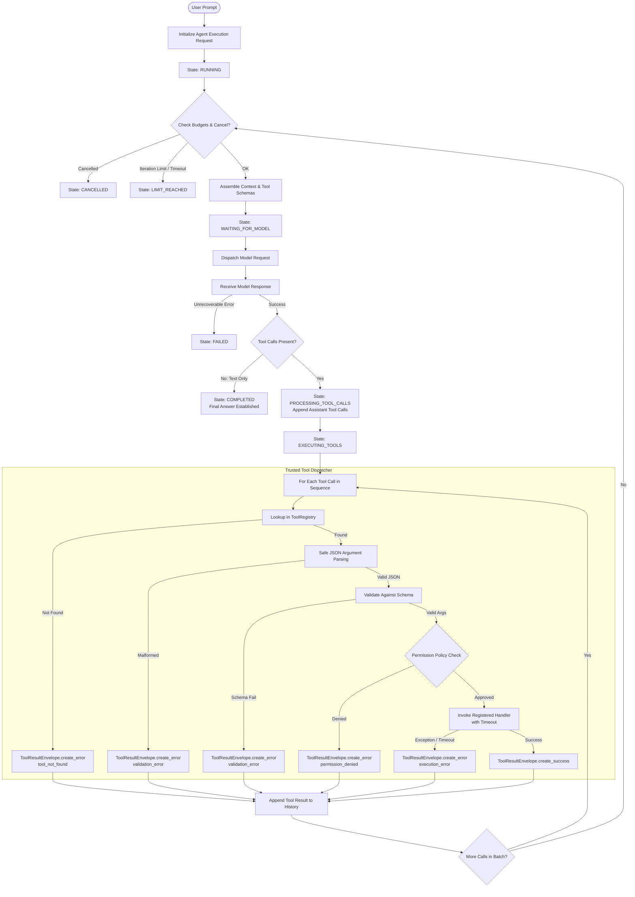
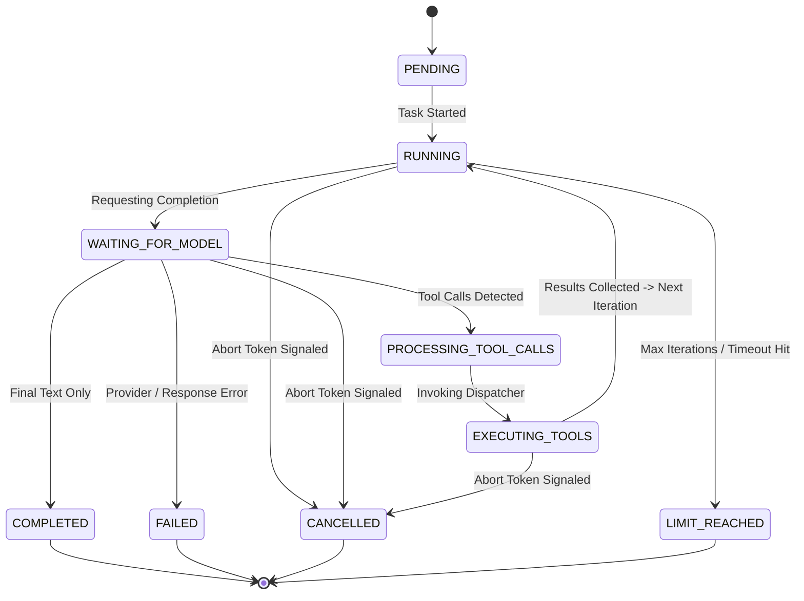

# Agent Execution Loop Architecture Specification

- **Project:** Chatbot — Agent Runtime
- **Module:** Phase 3 — Agent Execution Loop
- **Status:** Architectural Specification & Design Authority
- **Authority:** `sources/2604.14228v3.pdf` (Sections 3.5, 4.1, 4.2, 4.4, 4.5, 5), `docs/phases.md`, `AGENTS.md`
- **Date:** 2026-11-14

---

## 1. Architectural Philosophy & Overview

In accordance with the foundational findings of `sources/2604.14228v3.pdf` (Table 1 and Section 2.1):
1. **Minimal Scaffolding, Maximal Operational Harness:** The model is responsible for reasoning about what to do; the runtime harness is responsible for deterministically executing, validating, and constraining actions. We avoid rigid graph-based control flows and implement a reactive loop with strict perimeter boundaries.
2. **Untrusted Model Output:** Every tool call proposed by the model is treated as untrusted input. The model cannot authorize its own actions, cannot execute code directly, and cannot bypass schemas or execution budgets.
3. **Deterministic State & Lifecycle Management:** The runtime strictly owns state transitions, budgets (iteration limits, tool call limits, wall-clock timeouts), and cancellation.



---

## 2. Explicit Runtime State Transitions

The execution loop enforces a strict finite state machine (FSM). Terminal states (`COMPLETED`, `FAILED`, `CANCELLED`, `LIMIT_REACHED`) are permanently immutable.



### State Definitions:
1. `PENDING`: Task record created, awaiting execution dispatch.
2. `RUNNING`: Execution loop active; checking budgets and assembling context.
3. `WAITING_FOR_MODEL`: HTTP request in-flight to upstream model endpoint.
4. `PROCESSING_TOOL_CALLS`: Model returned tool call requests; preparing argument structures.
5. `EXECUTING_TOOLS`: Sequentially executing registered tool handlers via the dispatcher.
6. `COMPLETED`: Terminal state. Model produced a final textual response without tool calls.
7. `FAILED`: Terminal state. Unrecoverable model error, network partition, or unhandled runtime crash.
8. `CANCELLED`: Terminal state. Explicit cancellation requested by operator/user.
9. `LIMIT_REACHED`: Terminal state. Iteration budget, tool call limit, or wall-clock timeout exceeded.

---

## 3. Message Models & OpenAI Wire Compatibility

To ensure full compatibility with OpenAI-compatible vLLM endpoints serving Qwen2.5-Coder:

### Conversation Sequence Structure:
```json
[
  {
    "role": "system",
    "content": "You are a helpful coding assistant..."
  },
  {
    "role": "user",
    "content": "Calculate the square of 12."
  },
  {
    "role": "assistant",
    "content": "",
    "tool_calls": [
      {
        "id": "call_abc123",
        "type": "function",
        "function": {
          "name": "calculator",
          "arguments": "{\"operation\":\"square\",\"number\":12}"
        }
      }
    ]
  },
  {
    "role": "tool",
    "tool_call_id": "call_abc123",
    "name": "calculator",
    "content": "{\"call_id\":\"call_abc123\",\"tool_name\":\"calculator\",\"success\":true,\"output\":144,\"error\":null,\"metadata\":{}}"
  },
  {
    "role": "assistant",
    "content": "The square of 12 is 144."
  }
]
```

### Key Formatting Rules:
1. When an assistant message proposes tool calls:
   - `content` may be `""` or `null`.
   - `tool_calls` is a non-empty array of objects with `id`, `type="function"`, and `function={"name": "...", "arguments": "..."}`.
   - `arguments` is a JSON-encoded string (not an expanded dictionary), matching the OpenAI function calling specification.
2. When returning a tool result:
   - `role` must be `"tool"`.
   - `tool_call_id` must match the exact `id` from the assistant's `tool_calls` block.
   - `content` is a JSON string containing the serialized `ToolResultEnvelope`.
3. Strict 1-to-1 Pairing:
   - Every single requested tool call **must** receive a matching tool result message before the next model request.
   - If a tool is unknown, invalid, denied, or crashes, the dispatcher returns a failure `ToolResultEnvelope` containing the exact `call_id`. The envelope is serialized into the tool response message so the model can adapt and recover without breaking provider schema constraints.

---

## 4. Trusted Tool Dispatcher Specification

The dispatcher sits between the untrusted model output and concrete Python execution handlers.

### Dispatcher Pipeline:
1. **Registry Lookup:** Queries `ToolRegistry.get(name)`. If `ToolNotFoundError` is raised, immediately returns `ToolResultEnvelope.create_error(..., error_category="tool_not_found")`.
2. **Argument Parsing:** If arguments are received as a JSON string, parses via `json.loads`. Rejects non-dict top-level payloads (e.g. raw arrays, numbers, null) with `error_category="validation_error"`.
3. **Contract Validation:** Calls `tool.validate_input(args)`. If `ToolValidationError` is raised, captures detailed validation issues and returns `error_category="validation_error"`.
4. **Permission Boundary:** Passes `(tool, args, context)` to the active `PermissionPolicy`. If denied, returns `error_category="permission_denied"`.
5. **Execution:**
   - If the handler is a coroutine (`asyncio.iscoroutinefunction(handler)`), invokes directly with `asyncio.wait_for(handler(**args), timeout)`.
   - If the handler is synchronous, invokes via `asyncio.to_thread` with `asyncio.wait_for(...)` to guarantee the FastAPI / asyncio event loop is never blocked.
6. **Exception Capturing:** Any unhandled exception in the tool handler is caught, logged with traceback internally, and converted to `ToolResultEnvelope.create_error(..., error="Tool execution failed: <message>", error_category="execution_error")`. Secrets and raw system exceptions are never exposed to the model.

---

## 5. Execution Budgets & Recovery Mechanisms

### Budgets Enforced:
1. **`max_iterations` (Default: 20, Range: 1–100):** Upper bound on the number of model interaction cycles. Prevents infinite conversation loops.
2. **`max_tool_calls` (Default: 50, Range: 1–200):** Upper bound on total tool invocations across the task. Prevents recursive tool-call exhaustion.
3. **`tool_timeout_seconds` (Default: 30.0s, Range: 0.5–300.0s):** Per-tool execution timeout.
4. **`task_timeout_seconds` (Default: 300.0s, Range: 1.0–1800.0s):** Total wall-clock time limit for the entire task.

### Recovery from Tool Denials & Validation Errors:
In alignment with `2604.14228v3.pdf` Section 5.2, permission denials and schema errors are treated as **routing signals** to the model:
- The error is formatted into the tool response.
- The loop continues to the next model call.
- The model observes why the call failed (e.g., "Missing required parameter 'filepath'") and can correct its arguments in the subsequent turn.

---

## 6. Runtime Event Interface & SSE Streaming

Every major transition emits an immutable `RuntimeEvent`:

| Event Type | Emitted When | Payload Content |
|---|---|---|
| `task_created` | Task is received and queued | `prompt`, `max_tokens` |
| `model_request_started` | Prompt/messages sent to vLLM | `model`, `iteration`, `message_count` |
| `model_response_received` | Raw completion received from vLLM | `finish_reason`, `tool_call_count`, `usage` |
| `tool_requested` | Model proposed a tool call | `call_id`, `tool_name`, `arguments` |
| `tool_validated` | Arguments passed schema validation | `call_id`, `tool_name` |
| `tool_rejected` | Arguments failed schema validation | `call_id`, `tool_name`, `errors` |
| `permission_denied` | Permission policy rejected execution | `call_id`, `tool_name`, `reason` |
| `tool_execution_started` | Handler invocation begins | `call_id`, `tool_name` |
| `tool_completed` | Handler finished execution | `call_id`, `tool_name`, `success`, `duration_ms` |
| `tool_execution_failed` | Handler raised exception / timed out | `call_id`, `tool_name`, `error` |
| `task_cancelled` | Cancellation token was signaled | `iteration`, `elapsed_seconds` |
| `task_limit_reached` | Iteration or budget limit exceeded | `limit_type`, `iterations`, `tool_calls` |
| `task_terminal` | Final state reached | `status`, `response_text`, `error` |

### Streaming Guarantees:
- Events are yielded in strict chronological order.
- SSE streams replay historical events first upon connection, then stream live events.
- Client disconnection does not cancel the background task unless the explicit `/api/tasks/{task_id}/cancel` endpoint is invoked.
