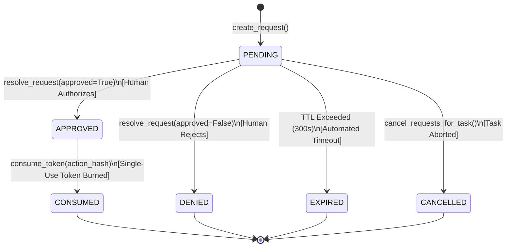

# Phase 5 — Approval Lifecycle & Exact-Action Binding Report
## State Machine, Token Consumption & In-Memory Concurrency

**Document Reference:** `docs/reports/phase-5/phase-5-approval-lifecycle.md`  
**Phase:** Phase 5 — Shell Execution, Approvals, and Permission Policy  
**Target Environment:** Windows 11, Python 3.14.6  
**Authority:** `2604.14228v3.pdf` (Sections 5.1 & 9.2) and Phase 3 Audit Finding OBS-02  
**Execution Date:** 2026-11-14

---

## 1. Approval Lifecycle State Machine

### 1.1 State Definitions & Invariants

1. **`PENDING`:** Initial state upon creation. Request is waiting for human operator authorization via the web GUI or REST API (`POST /api/tasks/{task_id}/approve`).
2. **`APPROVED`:** Human operator approved the exact request. Token is eligible for immediate single-use consumption.
3. **`DENIED`:** Human operator rejected the request. Dispatcher returns an error envelope (`permission_denied`) to the agent loop.
4. **`EXPIRED`:** Request exceeded its Time-to-Live (default 300 seconds) without human response. Execution fails closed with `approval_timeout`.
5. **`CANCELLED`:** The parent task was cancelled by the user while the modal was open. Execution terminates immediately.
6. **`CONSUMED`:** The approval token was presented, verified against its cryptographic action hash, and burned. The token can never be reused.

---

## 2. Exact-Action Cryptographic Binding

To prevent TOCTOU (Time-of-Check to Time-of-Use) attacks or parameter tampering between approval grant and subprocess launch, `ApprovalRequest` binds execution parameters using a deterministic SHA-256 hash:

$$\text{action\_hash} = \text{SHA256}(\text{task\_id} \parallel \text{tool\_name} \parallel \text{canonical\_cwd} \parallel \text{sorted\_arguments\_json})$$

### Verification Evidence:
- **Valid Hash:** When the exact approved parameters are dispatched, hash verification succeeds and the token is consumed (`tests/test_approval.py::test_single_use_token_consumption`).
- **Tampered Parameter Rejection:** When arguments are modified after approval, `consume_token` detects the hash mismatch and raises `InvalidApprovalTokenError` (`tests/test_approval.py::test_action_hash_mismatch_rejected`).

---

## 3. Single-Use Token Consumption (Replay Prevention)

- **Rule:** An approval grant authorizes exactly one execution attempt.
- **Verification:** When an approved request is consumed, its status transitions to `CONSUMED`. A second attempt with the same token raises `ApprovalAlreadyConsumedError` (`tests/test_approval.py::test_single_use_token_consumption`).

---

## 4. In-Memory Volatility & Resolution of OBS-02

### 4.1 Resolution of OBS-02 (Approval-Store Synchronization)
- Phase 3 audit finding **OBS-02** noted that the approval store synchronization in `TaskService` required formalization for concurrent approvals.
- Phase 5 resolves this completely in `ApprovalManager`:
  - Uses a dedicated re-entrant lock (`threading.RLock`) protecting all in-memory structures (`_requests`, `_task_call_map`, `_events`).
  - Concurrent requests, resolutions, cancellations, and expirations acquire the lock cleanly with zero race conditions.
  - Async task suspension uses `asyncio.Event`, allowing non-blocking waiting without thread spinning.

### 4.2 In-Memory Volatility (Compliance with `2604.14228v3.pdf` §9.2)
- Approvals exist exclusively in volatile process memory (`ApprovalManager._requests`).
- Approvals are **never** persisted to SQLite database tables or JSONL event transcripts.
- If the server process restarts, all approval tokens vanish. Resumed sessions cannot inherit or replay prior approval grants.

---
**Approval Lifecycle Verdict:** PASS — State machine, single-use consumption, exact-action binding, and concurrency verified.
