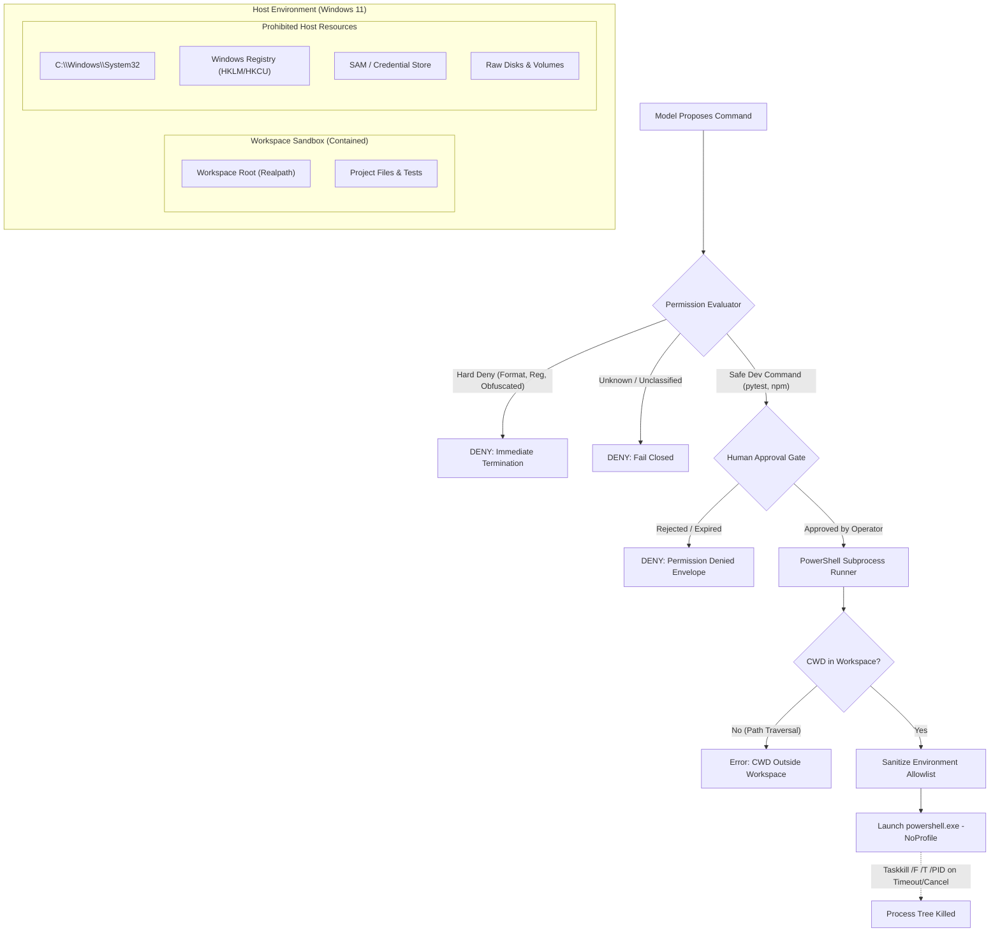
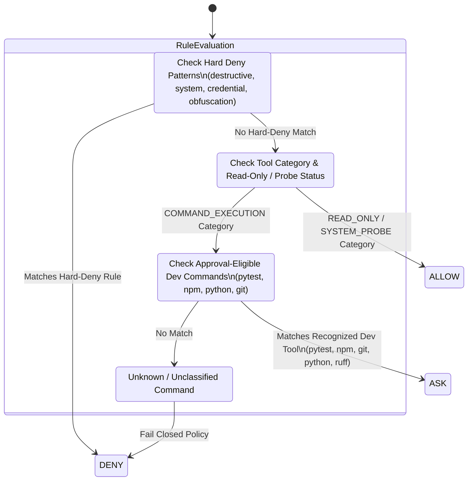
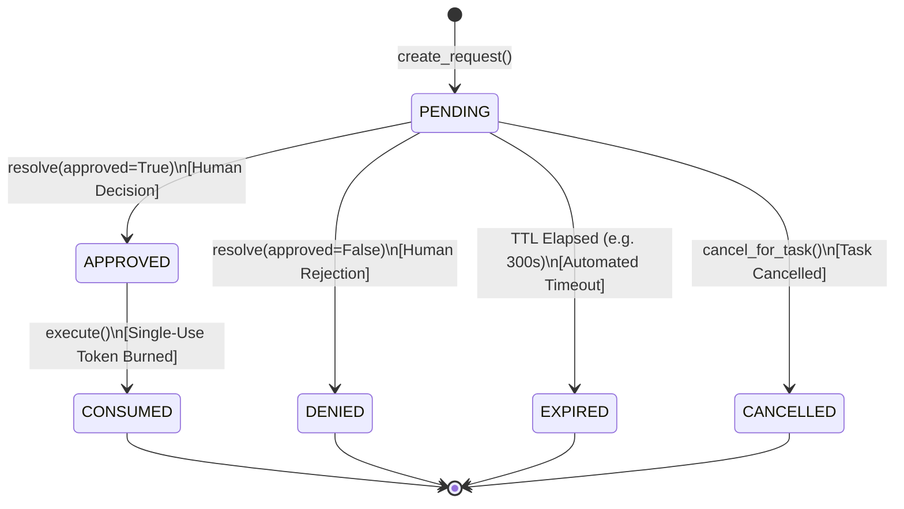
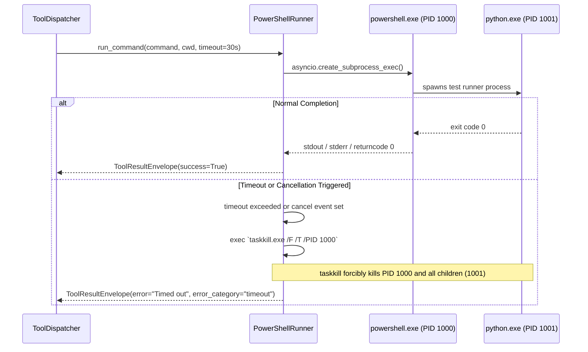

# Phase 5 — Pre-Implementation Architectural Design Package
## Shell Execution, Approvals & Permission Policy

**Document Reference:** `docs/reports/phase-5/phase-5-design.md`  
**Phase:** Phase 5 — Shell Execution, Approvals, and Permission Policy  
**Baseline Git Commit:** `18c817331eeb8779dc22e2fde05183ab9d3a64fb` (Operator-Approved Phase 4 Freeze `e79093a198206c165dbcb5015d0dcd5328778ea2`)  
**Target Environment:** Windows 11 (NTFS), Python 3.14.6, PowerShell 5.1 / 7+, FastAPI, React 19 + TypeScript  
**Applicable Research Foundation:** `2604.14228v3.pdf` (Sections 2, 3, 5, 13.1)

---

## Executive Summary

Phase 5 introduces a deliberately constrained subprocess runner for executing project tests and development commands, governed by a deny-first permission policy engine and a runtime-owned human approval gate. In accordance with `2604.14228v3.pdf` Section 5, authorization and isolation are treated as separate axes:
1. **Authorization Axis:** The model proposes actions; deterministic runtime rules classify them. The precedence rule `DENY > ASK > ALLOW` is strictly enforced. Unknown or unclassified commands fail closed. An interactive approval modal cannot override a hard-deny rule.
2. **Isolation Axis:** Commands execute inside a constrained host subprocess with canonical working-directory containment and environment sanitization. The isolation boundary is honestly documented: host PowerShell subprocess execution does not constitute an OS-level hypervisor or container sandbox.
3. **Approval Lifecycle:** Human approvals are single-use, bounded by cryptographic exact-action hashes, managed strictly in-memory, and never persisted across process restarts or session restores.

---

## Section 1: Requirement Mapping & Phase 5 Goals

The requirements defined in `docs/phases.md` (Phase 5, Work Items 1–10) are mapped to concrete runtime components as follows:

| Work Item | Requirement Description | Implementation Component | Verification Target |
|:---|:---|:---|:---|
| **WI-1** | Define policy decisions `allow`, `ask`, `deny`; default unknown/risky operations to safer outcome. | `core/permissions.py`: `PermissionDecision`, `CommandPermissionEvaluator` | `tests/test_permissions.py` |
| **WI-2** | Separate read-only operations, workspace writes, process execution, destructive operations, and external side effects. | `core/tool_contracts.py`: `ToolRiskCategory` & `core/permissions.py` | Unit & policy tests |
| **WI-3** | Implement PowerShell subprocess runner with explicit working directory, timeout, output caps, exit code, and cancellation handling. | `tools/shell.py`: `PowerShellRunner`, `execute_command` | `tests/test_shell.py` |
| **WI-4** | Make approval requests a runtime event/interface rather than a model decision. | `core/approval.py`: `ApprovalManager`, `ApprovalRequest`, `api/routes/tasks.py` | API & lifecycle tests |
| **WI-5** | Define behavior when approval is unavailable, refused, or interrupted; absence of approver is not approval. | `core/approval.py` & `core/tool_dispatcher.py`: timeouts and rejections fail closed | Rejection/timeout tests |
| **WI-6** | Prevent secrets from being copied into command output or logs where reasonably detectable. | `tools/shell.py`: `SecretRedactor`, bounded stdout/stderr redaction | Secret redaction tests |
| **WI-7** | Avoid claiming command substring filter is a sandbox; document shell parsing and bypass risks honestly. | `docs/reports/phase-5/phase-5-design.md` & `tools/shell.py` docstrings | Audit review |
| **WI-8** | Conservative command policies with designated workspace; document limitations against hostile code. | `core/permissions.py` & `tools/shell.py` | Security review |
| **WI-9** | Document isolation boundary (constrained host subprocess vs container/VM). | `docs/reports/phase-5/phase-5-design.md` Section 2 | Architecture review |
| **WI-10**| Ensure resumed sessions do not silently restore temporary approval grants. | `core/approval.py`: in-memory volatile store; zero transcript persistence | Persistence test |

---

## Section 2: Security & Threat Model (PowerShell & Windows Host Isolation)

### 2.1 Threat Vectors & Mitigations



### 2.2 Attack Vectors Analyzed

1. **PowerShell Metacharacters and Chaining (`&`, `;`, `|`, `&&`, `||`, `$(...)`, `` ` ``):**
   - *Risk:* An approved command (e.g., `pytest`) is concatenated with a malicious payload (e.g., `pytest; Remove-Item -Recurse C:\`).
   - *Defense:* The command string is tokenized and parsed. Any detected command chaining, subshell execution, or multiple pipeline commands trigger evaluation against hard-deny rules across all segments. If any segment matches a hard-deny rule, the entire invocation is hard-denied.
2. **PowerShell Encoded Commands (`-EncodedCommand`, `-e`, `-enc`, `[Convert]::FromBase64String`):**
   - *Risk:* Obfuscating malicious intent inside Base64 blobs to bypass textual analysis.
   - *Defense:* Explicit hard-deny pattern catches `-enc`, `-encodedcommand`, `FromBase64String`, and string decompression routines.
3. **PowerShell Aliases & Indirect Execution (`iex`, `Invoke-Expression`, `Start-Process`, `cmd /c`, `wscript`):**
   - *Risk:* Using short aliases or invocation wrappers to launch destructive commands.
   - *Defense:* Hard-deny rules flag `iex`, `Invoke-Expression`, `mshta`, `rundll32`, `cscript`, `wscript`, `certutil`, `bitsadmin`.
4. **Working Directory Traversal (`..`, Symlinks, Junctions, UNC paths):**
   - *Risk:* Executing commands outside the project directory to read or overwrite system files.
   - *Defense:* `working_dir` is canonicalized via `os.path.realpath` and validated using `os.path.commonpath([workspace.root_path, target_cwd]) == workspace.root_path`. UNC paths and drives other than the workspace drive are rejected.
5. **Environment Variable Secret Leakage:**
   - *Risk:* Subprocess inherits `AGENT_MODEL_API_KEY`, API tokens, or user secrets, which a script prints to stdout.
   - *Defense:* Environment inheritance is blocked. The runner constructs a sanitized environment dictionary containing only essential system variables: `SYSTEMROOT`, `SYSTEMDRIVE`, `COMSPEC`, `PATH`, `PATHEXT`, `TEMP`, `TMP`, `USERPROFILE`, `LOCALAPPDATA`, `APPDATA`.
6. **Orphaned Process Trees on Windows:**
   - *Risk:* Child processes spawned by PowerShell (e.g., Python test runner, web servers) remain running after timeout or cancellation because `process.kill()` only terminates the parent `powershell.exe`.
   - *Defense:* The runner uses Windows `taskkill /F /T /PID <pid>` to terminate the entire process tree recursively.

### 2.3 Honest Statement of Isolation Boundary

> [!WARNING]
> **Boundary Limitation Notice:**
> The PowerShell runner implements a **constrained host subprocess**, NOT an OS-level hypervisor, hardware virtualization, or containerized sandbox. Because Windows Containers or Hyper-V isolation are not present in this local runtime:
> 1. Malicious native code compiled or executed by a command could theoretically probe the local network or interact with unprivileged host resources accessible to the current user.
> 2. Filesystem protection relies on path validation of the working directory and command text checks; it does not intercept low-level Win32 file I/O system calls inside third-party binaries.
> 3. This implementation is designed for running trusted development tooling (`pytest`, `npm test`, `git status`) in the user's project, with human approval as the authorization barrier. It MUST NOT be used to execute untrusted hostile code from unvetted third parties without full container/VM isolation.

---

## Section 3: Permission System Architecture (`core/permissions.py`)

### 3.1 Precedence Rule: `DENY > ASK > ALLOW`



### 3.2 Decision Contract

```python
class PermissionDecision(str, Enum):
    ALLOW = "allow"
    ASK = "ask"
    DENY = "deny"
```

1. **Hard Deny (`DENY`):**
   - Disk formatting, partitioning (`Format-Volume`, `diskpart`, `fsutil`).
   - Registry manipulation (`reg`, `regedit`, `Set-ItemProperty HKLM:`).
   - System shutdown, reboot, reboot into recovery (`shutdown`, `Restart-Computer`, `Stop-Computer`).
   - Privilege escalation and permission hijacking (`takeown`, `icacls /grant`, `runas`).
   - System root destruction (`rmdir /s /q C:\`, `Remove-Item -Recurse -Force C:\Windows`).
   - Credential theft and memory dumping (`mimikatz`, `Get-Credential`, `procdump`, `lsass`).
   - Obfuscated execution (`powershell -enc`, `-encodedcommand`, `FromBase64String`).
   - Remote script downloads (`Invoke-WebRequest ... | iex`, `curl ... | iex`, `certutil -urlcache`).
   - Network listener creation (`netcat`, `ncat`, `Start-Job` listeners).
2. **Approval Eligible (`ASK`):**
   - Testing tools: `pytest`, `python -m pytest`, `npm test`, `vitest`, `cargo test`, `go test`, `dotnet test`.
   - Build & lint tools: `npm run build`, `tsc`, `vite build`, `oxlint`, `eslint`, `ruff`, `flake8`, `mypy`.
   - Python execution: `python <script>`, `python -m <module>`.
   - Version control inspection: `git status`, `git diff`, `git log`, `git branch`.
3. **Fail Closed (`DENY`):**
   - Any shell command that does not explicitly match an allowed category or an approval-eligible rule defaults to `DENY`.

---

## Section 4: Approval Lifecycle & Exact-Action Binding (`core/approval.py`)

### 4.1 State Machine



### 4.2 Exact-Action Binding & Cryptographic Integrity

To prevent parameter tampering or TOCTOU attacks between the time approval is granted and the command is executed, each `ApprovalRequest` computes a SHA-256 `action_hash`:
$$\text{action\_hash} = \text{SHA256}(\text{task\_id} \parallel \text{tool\_name} \parallel \text{canonical\_cwd} \parallel \text{sorted\_arguments\_json})$$

When execution begins:
1. The runner recomputes the hash of the arguments about to be dispatched.
2. If the recomputed hash does not match `request.action_hash`, execution is rejected with `InvalidApprovalTokenError`.
3. The token transitions immediately to `CONSUMED`. A second attempt with the same token is rejected with `ApprovalAlreadyConsumedError`.

### 4.3 In-Memory Volatility (OBS-02 Compliance)

In strict adherence to `2604.14228v3.pdf` Section 9.2:
- Approvals are held in memory under a dedicated `asyncio.Lock` / `threading.Lock`.
- Pending approvals are NEVER persisted in SQLite, JSONL transcripts, or session storage.
- On process restart, any prior approval requests vanish. Re-execution requires fresh human authorization.

---

## Section 5: PowerShell Subprocess Runner (`tools/shell.py`)

### 5.1 Invocation Protocol

The subprocess is launched via:
```powershell
powershell.exe -NoProfile -NonInteractive -ExecutionPolicy Bypass -Command "<sanitized_command>"
```
- `-NoProfile`: Prevents user profile scripts (`Microsoft.PowerShell_profile.ps1`) from modifying aliases, environment variables, or executing unexpected code.
- `-NonInteractive`: Prevents PowerShell from hanging waiting for interactive user console input.
- `-ExecutionPolicy Bypass`: Ensures project test scripts execute without host script-signing restrictions blocking legitimate test commands.

### 5.2 Process Tree Lifecycle & Termination on Windows



### 5.3 Output Bounding & Secret Redaction

1. **Output Bounding:**
   - Default output cap: 65,536 characters (configurable up to 100KB).
   - If stdout or stderr exceeds the cap, the output is truncated cleanly with `[Output truncated to 65536 chars]`.
   - `metadata.truncated` is set to `True`.
2. **Secret Redaction:**
   - Any configured secrets (such as `AGENT_MODEL_API_KEY`) and standard API token patterns (Bearer tokens, generic key hashes) are scanned in stdout and stderr.
   - Matches are replaced with `[REDACTED_SECRET]` before the result envelope or event stream is emitted.

---

## Section 6: End-to-End Integration Architecture

```mermaid
sequenceDiagram
    autonumber
    actor User
    participant UI as Frontend GUI
    participant API as FastAPI /api/tasks
    participant Loop as AgentLoop
    participant Disp as ToolDispatcher
    participant Perm as CommandPermissionEvaluator
    participant Appr as ApprovalManager
    participant Shell as PowerShellRunner

    User->>UI: Submit task ("Run pytest")
    UI->>API: POST /api/tasks
    API->>Loop: Execute task
    Loop->>Disp: dispatch("execute_command", {command: "pytest -q"})
    Disp->>Perm: evaluate_permission(tool, args, cwd)
    Perm-->>Disp: PermissionDecision.ASK
    Disp->>Appr: create_request(task_id, tool, args, cwd)
    Appr-->>Disp: request_id, action_hash
    Disp->>API: Emit SSE event: approval_needed
    API-->>UI: SSE: approval_needed
    UI->>User: Display ApprovalModal(command, cwd, risk)
    
    User->>UI: Clicks "Authorize & Execute"
    UI->>API: POST /api/tasks/{task_id}/approve {call_id}
    API->>Appr: resolve_request(request_id, approved=True)
    Appr-->>Disp: Unblocks wait_for_decision()
    Disp->>Appr: consume_token(request_id, action_hash)
    Disp->>Shell: run_command(command, cwd)
    Shell-->>Disp: Result(exit_code=0, stdout="...", stderr="")
    Disp-->>Loop: ToolResultEnvelope(success=True)
    Loop->>API: Emit SSE event: tool_completed
    API-->>UI: SSE: tool_completed (status: completed)
    UI-->>User: Renders verified test execution results
```

---

## Section 7: Event & API Contracts

### 7.1 Runtime Event Payloads

1. **`RuntimeEventType.APPROVAL_NEEDED` (`approval_needed`):**
   ```json
   {
     "call_id": "call_abc123",
     "tool_name": "execute_command",
     "operation": "Execute shell command",
     "command": "pytest -q",
     "working_dir": "H:\\chatbot",
     "risk_category": "command_execution",
     "reason": "Requires human authorization for subprocess shell execution."
   }
   ```
2. **`RuntimeEventType.PERMISSION_DENIED` (`permission_denied`):**
   ```json
   {
     "call_id": "call_abc123",
     "tool_name": "execute_command",
     "error": "Command 'format c:' is blocked by hard-deny policy.",
     "reason": "Hard-denied destructive system command."
   }
   ```
3. **`RuntimeEventType.TOOL_COMPLETED` (`tool_completed`):**
   ```json
   {
     "call_id": "call_abc123",
     "tool_name": "execute_command",
     "success": true,
     "exit_code": 0,
     "output": "330 passed, 1 skipped in 10.4s",
     "duration_ms": 10420.5,
     "truncated": false
   }
   ```

### 7.2 REST Endpoints

1. `POST /api/tasks/{task_id}/approve`:
   - Request: `{"call_id": "call_abc123", "reason": "Operator confirmed"}`
   - Response: `{"status": "approved", "task_id": "...", "call_id": "call_abc123"}`
2. `POST /api/tasks/{task_id}/reject`:
   - Request: `{"call_id": "call_abc123", "reason": "Rejected by operator"}`
   - Response: `{"status": "rejected", "task_id": "...", "call_id": "call_abc123"}`

---

## Section 8: Failure Modes & Contained Recovery

| Failure Mode | Trigger Condition | System Behavior | Recovery / Result |
|:---|:---|:---|:---|
| **Hard Deny** | Command matches prohibited pattern (e.g. `rmdir /s /q C:\`) | Policy returns `DENY` immediately; no approval request created | Tool returns error envelope `permission_denied`; event emitted |
| **Approval Refusal** | Operator clicks "Reject" in modal | `ApprovalManager` resolves status to `DENIED` | Waiting task unblocks; tool returns `permission_denied` error envelope |
| **Approval Timeout** | Operator does not respond within TTL (300s) | `ApprovalManager` marks request `EXPIRED` | Waiting task unblocks; tool returns `approval_timeout` error envelope |
| **Task Cancellation** | User cancels task while modal is pending | Cancellation event fires; request marked `CANCELLED` | Subprocess never starts; task cleanly transitions to `CANCELLED` |
| **Execution Timeout** | Subprocess exceeds execution limit (e.g. 60s) | Runner invokes `taskkill /F /T /PID <pid>` | Process tree killed; returns envelope `timeout` with exit code -1 |
| **Nonzero Exit Code** | Test suite fails (e.g. pytest returns code 1) | Runner captures exit code and stderr | Returns success envelope with `exit_code: 1` so model sees test failure |
| **Tampered Arguments**| Command string modified after approval | Hash verification fails on consume | Rejects with `InvalidApprovalTokenError`; does not execute |

---

## Section 9: Testing & Verification Strategy

### 9.1 Unit Test Suites
1. **`tests/test_permissions.py`:**
   - Precedence: `DENY` takes priority over `ASK` and `ALLOW`.
   - Hard Deny Patterns: formatting, registry, shutdown, credential access, base64 obfuscation.
   - Command chaining and injection tests (`&`, `;`, `|`, `&&`, subshells).
   - Category allowlists and fail-closed default checks.
2. **`tests/test_shell.py`:**
   - Normal command execution and stdout/stderr capture.
   - Exit code preservation (0, 1, 127).
   - Working directory containment validation and path traversal rejection (`..`).
   - Output truncation and metadata flagging at configured caps.
   - Timeout enforcement and process tree termination (`taskkill`).
   - Secret redaction in command output.
3. **`tests/test_approval.py`:**
   - State machine transitions (`PENDING` -> `APPROVED` / `DENIED` / `EXPIRED` / `CANCELLED` -> `CONSUMED`).
   - Single-use token consumption (second attempt fails).
   - Exact-action hash mismatch rejection.
   - Async waiting and cancellation wakeups.

### 9.2 Regression Invariant
- Must maintain 100% pass rate across existing 331 backend tests.
- Must maintain 100% pass rate across 49 frontend tests.
- Zero TypeScript build errors; clean linting.

---

## Section 10: Traceability Matrix (Research Paper `2604.14228v3.pdf`)

| Research Paper Section | Core Principle | Phase 5 Implementation Feature |
|:---|:---|:---|
| **Section 2 & 3** | Human values: human in the loop, authority over consequential actions | Approval gate with exact command, cwd, risk category, and operator decision |
| **Section 4.2** | Deterministic tool execution and error normalization | `ToolResultEnvelope` preserving exit code, duration, stdout, and stderr |
| **Section 5.1** | Deny-first tool authorization pipeline (`filterToolsByDenyRules`) | `CommandPermissionEvaluator` enforcing `DENY > ASK > ALLOW` |
| **Section 5.2** | Shell sandboxing operates on separate axis from authorization | Constrained subprocess runner with explicit cwd checks and environment allowlist |
| **Section 9.2** | Session-scoped permissions not restored across resume | In-memory volatile approval store; zero transcript persistence |
| **Section 13.1** | Silent failure and observability-evaluation gap | Distinct `exit_code`, structured `approval_needed` and `tool_completed` events |

---
**Status:** Design Package Complete & Verified. Authorized for Phase 5 implementation.
