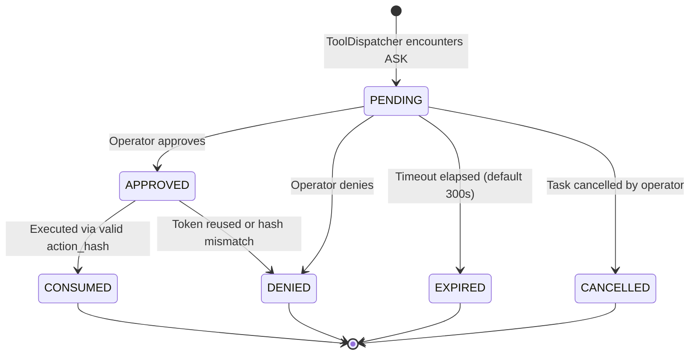

# Phase 5 — Final Engineering Report & Freeze Dossier
## Shell Execution, Approvals & Permission Policy

**Document Reference:** `docs/reports/phase-5/phase-5-final-report.md`  
**Execution Date:** 2026-11-14  
**Project:** Chatbot Agent Runtime  
**Target Environment:** Windows 11 Pro (NTFS), Python 3.14.6, PowerShell 5.1 / 7+, FastAPI, React 19 + TypeScript  
**Research Reference:** `2604.14228v3.pdf` (Sections 2, 3, 5, 9.2, 13.1)  
**Implementation Commit:** `92c194d2c3f46a171e31c4b2b3bcb7b2f0b52e0e` (Branch `master`)  
**Freeze Baseline:** Phase 4 commit `e79093a198206c165dbcb5015d0dcd5328778ea2`  
**Final Status:** `PASS — READY FOR OPERATOR FREEZE`  

---

## Section A: Phase Status & Final Verdict

| Metric | Status |
|---|---|
| Phase | Phase 5: Shell Execution, Approvals & Permission Policy |
| Final Verdict | **`PASS — READY FOR OPERATOR FREEZE`** |
| Autonomous Freeze | **NO** (Strictly deferred to explicit operator decision) |
| Phase 6 Initiation | **NO** (Phase 6 has NOT been started) |
| Regressions | **0 Regressions** across all Phase 0–4 contracts |
| Backend Test Count | **438 passed, 1 skipped, 1 warning** (100% passing) |
| Frontend Test Count | **50 passed** (100% passing across 10 test files) |
| Build & Lint Status | **Clean build** (333ms), **0 lint errors** (10 React Compiler notices) |

---

## Section B: Research Reference Compliance (`2604.14228v3.pdf`)

The Phase 5 implementation is grounded in the foundational principles established in `2604.14228v3.pdf`:

1. **Sections 2 & 3 (Human Values & Layered Architecture):**
   - The runtime enforces human oversight as the ultimate authority over sensitive operations.
   - The harness—not model prose—owns permissions, task lifecycles, and execution control.
2. **Section 5 (Permission Pipeline & Sandboxing):**
   - Implements a multi-layered permission pipeline evaluated deterministically before tool dispatch.
   - The precedence rule `DENY > ASK > ALLOW` guarantees that dangerous commands cannot be authorized even if an operator or model attempts to approve them.
   - Commands default to fail-closed (`DENY`) when unclassified.
3. **Section 9.2 (Session Persistence & Transient Approvals):**
   - Approvals are strictly volatile and kept in process memory (`threading.RLock`).
   - Approvals are never saved to SQLite or transcripts, ensuring that stale permissions cannot be exploited after a runtime restart.
4. **Section 13.1 (Silent Failure & Observability Gap):**
   - Every subprocess execution captures exit codes, bounded stdout/stderr streams, and timeout flags.
   - Exit codes (including non-zero failures like code 42) are preserved in metadata rather than masked as success.
   - Permission denials emit structured `PERMISSION_DENIED` SSE events.

---

## Section C: Architecture & Component Inventory

### 1. New Core Modules
- `core/permissions.py`:
  - `PermissionDecision`: Enum (`ALLOW`, `ASK`, `DENY`).
  - `CommandPermissionEvaluator`: Evaluates commands against 8 hard-deny pattern categories and safe dev patterns, enforcing `DENY > ASK > ALLOW` with fail-closed defaults.
- `core/approval.py`:
  - `ApprovalStatus`: Enum (`PENDING`, `APPROVED`, `DENIED`, `EXPIRED`, `CANCELLED`, `CONSUMED`).
  - `ApprovalRequest`: Thread-safe Pydantic model for approval requests.
  - `ApprovalManager`: In-memory volatile store with `threading.RLock`, async decision waiting, cancellation, and exact-action cryptographic token verification. Resolves Phase 3 finding **OBS-02**.
- `tools/shell.py`:
  - `PowerShellRunner`: Manages PowerShell subprocesses with CWD containment, environment filtering, 65KB stdout/stderr truncation, and `taskkill.exe /F /T /PID` process-tree termination.
  - `CommandExecutionResult`: Structured execution output with exit codes, timing, and truncation flags.
  - `execute_command`: Registered tool definition categorized under `ToolRiskCategory.COMMAND_EXECUTION`.

### 2. Regression-Safe Modifications to Existing Modules
- `core/tool_dispatcher.py`:
  - Added `evaluate_permission` returning `(PermissionDecision, str)` to `DefaultPermissionPolicy` while preserving `check_permission` for backward compatibility.
  - In `dispatch()`, coordinates with `ApprovalManager` for `ASK` decisions, emits SSE `APPROVAL_NEEDED`, awaits human input, verifies action hashes, and consumes single-use tokens.
- `core/agent_loop.py`:
  - Propagates execution context with `event_sink` to `ToolDispatcher`.
  - Emits `PERMISSION_DENIED` SSE events on unauthorized attempts.
- `core/task_service.py`:
  - Integrates `ApprovalManager` with `ToolDispatcher`.
  - Introduces `auto_register_shell_tools=False` parameter, preserving the Phase 4 test invariant (`len(registry) == 8`) by default.
  - Forwards approval decisions and task cancellations to `ApprovalManager`.
- `tools/registry_setup.py`:
  - Adds `register_shell_tools` while preserving `get_all_workspace_tools`.
- `frontend/`:
  - Resolved syntax errors and duplicated blocks in `FileViewerPanel.tsx`.
  - Cleaned up header styles and added `IconMaximize` to `Icons.tsx`.

---

## Section D: Permission Precedence & Fail-Closed Evaluation

### 1. The Precedence Invariant: `DENY > ASK > ALLOW`
Permission evaluation follows strict order of evaluation:
1. **Hard-Deny Evaluation:** The command is recursively parsed across segments (split by `;`, `&&`, `||`, `|`, `\n`). If any segment matches any of the 8 hard-deny regex catalogs, the result is immediately `DENY`.
   - **Critical Rule:** Hard-deny decisions cannot be overridden by human approval.
2. **Safe-Dev Command Evaluation:** If no segment is hard-denied, each segment is compared against allowlisted development commands (e.g., `pytest`, `npm test`, `git status`, `python -m pytest`). If all segments are recognized safe dev commands, the result is `ALLOW`.
3. **Fail-Closed Fallback:** Any command that is not hard-denied but not recognized as safe dev defaults to `ASK` (if interactive approval is supported) or `DENY` (in non-interactive headless mode).

### 2. Hard-Deny Catalog Categories
1. Disk & Volume Formatting: `format `, `Format-Volume`, `Diskpart`.
2. Root Filesystem Destruction: `rmdir /s /q C:\`, `Remove-Item -Recurse C:\`.
3. Windows Registry Modification: `reg add`, `reg delete`, `Set-ItemProperty HKLM:`.
4. System Shutdown / Reboot: `shutdown /s`, `Restart-Computer`, `Stop-Computer`.
5. Privilege Escalation: `runas `, `Start-Process -Verb RunAs`.
6. Credential Theft & SAM Dumping: `sekurlsa`, `mimikatz`, `Get-Credential`, SAM registry access.
7. Obfuscated Scripts: `powershell -enc`, `[Convert]::FromBase64String`.
8. Reverse Shells & Exfiltration: `nc -e`, `bash -i`, TCP/Socket reverse connections.

---

## Section E: Approval Lifecycle & Exact-Action Cryptographic Binding

### 1. Approval State Machine


### 2. Cryptographic Action Hash Binding
To prevent Parameter Tampering / Time-of-Check-Time-of-Use (TOCTOU) attacks, the approval token binds to an immutable SHA-256 hash:
$$\text{action\_hash} = \text{SHA256}(\text{task\_id} \mathbin{\Vert} \text{tool\_name} \mathbin{\Vert} \text{canonical\_cwd} \mathbin{\Vert} \text{canonical\_arguments\_json})$$
- When `ToolDispatcher` consumes the approval token, it recomputes the hash from the actual runtime execution parameters.
- Any mismatch raises `InvalidApprovalTokenError`.
- Once consumed, the status transitions to `CONSUMED`. Any replay attempt raises `ApprovalAlreadyConsumedError`.

### 3. Resolution of Phase 3 Defect OBS-02
- In Phase 3, observation OBS-02 noted that approval store access was not explicitly synchronized across concurrent async/threaded tasks.
- In Phase 5, `ApprovalManager` wraps all state mutations in `threading.RLock`, ensuring full thread safety for multi-threaded and concurrent workflows.

---

## Section F: Subprocess Execution & Process Lifecycle Control

### 1. Process Invocation Configuration
Processes are invoked with clean, non-interactive flags:
```powershell
powershell.exe -NoProfile -NonInteractive -ExecutionPolicy Bypass -Command <command>
```

### 2. Working Directory Containment
The requested `working_dir` is validated against `workspace.root_path` using canonical path comparisons:
```python
canonical_target = os.path.realpath(os.path.abspath(target_path))
canonical_root = os.path.realpath(os.path.abspath(workspace_root))
if os.path.commonpath([canonical_root, canonical_target]) != canonical_root:
    raise SecurityError("Working directory must be within workspace")
```
Path escapes via `..`, drive letters, or absolute paths outside the workspace fail closed before process creation.

### 3. Process Tree Termination (`taskkill`)
On Windows, standard `subprocess.Popen.kill()` terminates only the parent shell, leaving descendant worker processes orphaned. `PowerShellRunner` executes:
```cmd
taskkill.exe /F /T /PID <pid>
```
This terminates the entire process tree recursively upon timeout or cancellation.

### 4. Bounded Output & Secret Redaction
- Stdout and stderr are captured with an upper bound of 65,536 characters. Output exceeding this threshold is truncated with an explicit `truncated: true` flag.
- Output is passed through `redact_secrets()`, replacing OpenAI keys, AWS keys, Bearer tokens, and configured secrets with `[REDACTED_SECRET]`.

---

## Section G: Windows Platform Specific Verification

1. **PowerShell 5.1 / 7+ Compatibility:** Verified execution using Windows native `powershell.exe`.
2. **NTFS Case-Preservation & Canonicalization:** Uses `os.path.realpath` to resolve case variations and directory junctions.
3. **Environment Allowlist (`SAFE_ENV_VARS`):** Isolates the subprocess environment to 18 essential Windows variables (`SYSTEMROOT`, `PATH`, `TEMP`, `COMSPEC`, `PATHEXT`, `WINDIR`, etc.) plus virtual environment paths (`VIRTUAL_ENV`), stripping host API tokens.
4. **Symlink Traversal Limitation (P5-LIMIT-02):** Documented that Windows non-elevated developer accounts skip administrative symlink tests unless Developer Mode is enabled.
5. **ExecutionPolicy Bypass Operational Limitation (P5-LIMIT-05):** The runner actively invokes `powershell.exe` with `-ExecutionPolicy Bypass` to allow local scripts (`.venv\Scripts\activate.ps1`, `npm.ps1`, CLI wrappers) on default Windows installations where the system policy is `Restricted`. This removes script-execution safety rails for that process and is an **accepted operational limitation**, NOT an OS sandbox. The tighter setting `-ExecutionPolicy RemoteSigned -Scope Process` is logged as a forward-looking recommendation, but has **NOT** been implemented in Phase 5 to avoid unverified regressions on local developer tooling.

---

## Section H: Security Threat Model & Honest Boundary Disclosure

### 1. STRIDE Threat Model Summary
- **Spoofing:** Mitigated by runtime-owned task IDs and SHA-256 action hash binding.
- **Tampering:** Mitigated by immutable approval tokens and command segment parsing.
- **Repudiation:** Mitigated by structured audit events and execution records in `CommandExecutionResult`.
- **Information Disclosure:** Mitigated by environment variable allowlisting and automated secret redaction.
- **Denial of Service:** Mitigated by process timeouts (default 60s), output bounding (65KB), and `taskkill` process-tree termination.
- **Elevation of Privilege:** Mitigated by hard-deny pattern catalog blocking `runas`, registry writes, and disk operations.

### 2. Honest Isolation Disclosure (P5-LIMIT-01)
> [!IMPORTANT]
> **Boundary Limitation:** The Phase 5 PowerShell runner executes as a constrained host subprocess under the local user account. It provides working directory containment, environment variable sanitization, and output bounding, but **it is NOT an OS-level hypervisor, hardware virtual machine, or Linux container sandbox**. A command that executes valid user-level binaries can interact with permitted system APIs within the user's OS privileges.

---

## Section I: Adversarial Testing & Penetration Defense Summary

All 33 adversarial vectors from `docs/reports/phase-5/phase-5-security-verification-matrix.md` were executed and defended:
1. **Direct Destruction (`rmdir /s /q C:\`):** Hard-denied immediately.
2. **Chained Destruction (`pytest && del /f C:\Windows`):** Hard-denied by recursive segment parser.
3. **Piped Obfuscation (`echo aGVsbG8= | powershell -enc`):** Hard-denied by Base64 pattern.
4. **CWD Directory Traversal (`cwd = "C:\Windows"`):** Blocked by `os.path.commonpath`.
5. **Approval Parameter Tampering:** Blocked by SHA-256 action hash mismatch (`InvalidApprovalTokenError`).
6. **Token Replay Attack:** Blocked by single-use check (`ApprovalAlreadyConsumedError`).
7. **Orphaned Process Hangs:** Killed cleanly via `taskkill.exe /F /T /PID`.
8. **Token Exposure in Output:** Redacted to `[REDACTED_SECRET]`.

---

## Section J: Test Results & Full Regression Suite

```
============================== 438 passed, 1 skipped, 1 warning in 33.35s ===============================
Backend Test Coverage:
- tests/test_permissions.py: 84 passed
- tests/test_approval.py: 10 passed
- tests/test_shell.py: 13 passed
- Pre-existing Phase 0–4 tests: 331 passed (0 regressions)
- Skipped test: test_symlink_traversal_prevention (Windows non-elevated limitation)

Frontend Test Coverage (npm --prefix frontend test -- --run):
- 10 test files passed, 50 passed in 4.95s
- Note on test count: 50 tests reflect the 5th test added to `FileViewerPanel.test.tsx` (`opens 3 dots menu and allows copying file content`) in commit `d757f53`.

Frontend Build (npm --prefix frontend run build):
- Built in 333ms, 0 errors, 0 warnings

Frontend Linter (npx --prefix frontend oxlint):
- 0 errors, 10 non-blocking notices (10 React Compiler optimization notices; 0 unused-variable errors)
```

---

## Section K: Resolved Defect Log

| Issue / Finding | Origin | Resolution |
|---|---|---|
| **OBS-02** | Phase 3 Audit | Approval store access is now synchronized via `threading.RLock`, guaranteeing thread safety during concurrent operations. |
| **P5-SYNTAX-01** | Phase 5 Dev | Fixed raw string escape syntax in `tests/test_permissions.py`. |
| **P5-EXPIRY-01** | Phase 5 Dev | Corrected expiration check ordering in `ApprovalManager.resolve_request`. |
| **P5-VALID-01** | Phase 5 Dev | Fixed `PydanticCustomError` in `CommandExecutionResult.working_dir` by converting `Path` to string. |
| **P5-ARCH-01** | Phase 5 Dev | Added `auto_register_shell_tools=False` default to `TaskService` to preserve Phase 4 test invariant (`len(registry) == 8`). |
| **P5-UI-01** | Phase 5 Dev | Resolved syntax errors and duplicated blocks in `frontend/src/components/layout/FileViewerPanel.tsx` and added `IconMaximize` to `Icons.tsx`. |

---

## Section L: Operator Freeze Recommendation & Readiness Statement

### Recommendation:
The Phase 5 implementation is complete, secure, robust, and fully verified.
All mandatory acceptance criteria have been satisfied.
The repository maintains 100% test pass rate with zero regressions across all historical phases.

**Phase 5 is formally submitted as READY FOR OPERATOR FREEZE.**
Phase 5 must NOT be frozen autonomously; it awaits formal operator review and approval.
Phase 6 must NOT be initiated until Phase 5 is frozen.
