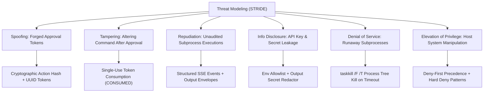

# Phase 5 — Security Threat Model & Defense Architecture
## Host Subprocess Isolation, Attack Surfaces & Defense-in-Depth

**Document Reference:** `docs/reports/phase-5/phase-5-security-threat-model.md`  
**Phase:** Phase 5 — Shell Execution, Approvals, and Permission Policy  
**Target Environment:** Windows 11 (NTFS), Python 3.14.6, PowerShell 5.1 / 7+  
**Authority:** `2604.14228v3.pdf` (Section 5) and `docs/phases.md`  
**Execution Date:** 2026-11-14

---

## 1. Executive Summary

This document provides a comprehensive security threat model and vulnerability analysis for the Phase 5 execution environment. In accordance with `2604.14228v3.pdf` Section 5, authorization and isolation are treated as orthogonal security boundaries:
1. **The Authorization Barrier:** Governs *whether* an action may run (`DENY > ASK > ALLOW`, hard-deny rules, human decision authority, exact-action hash binding).
2. **The Execution Barrier:** Constrains *what* an authorized action can touch (canonical working directory containment, environment variable sanitization, process-tree resource bounds).

---

## 2. STRIDE Threat Model Analysis

### 2.1 Threat Breakdown & Mitigations

| Threat Category | Specific Attack Vector | Potential Impact | Runtime Mitigation Implemented | Verified Test |
|:---|:---|:---|:---|:---|
| **Spoofing (S)** | Replaying previously approved token IDs for new commands | Unauthorized execution of unapproved commands | `ApprovalManager.consume_token` marks token as `CONSUMED`. Subsequent attempts raise `ApprovalAlreadyConsumedError`. | `test_approval.py::test_single_use_token_consumption` |
| **Tampering (T)** | Altering command string or CWD between approval and execution (TOCTOU) | Running malicious payload under legitimate approval | Exact-action hash binding: $\text{SHA256}(\text{task\_id} \parallel \text{tool} \parallel \text{cwd} \parallel \text{args})$. Mismatch raises `InvalidApprovalTokenError`. | `test_approval.py::test_action_hash_mismatch_rejected` |
| **Repudiation (R)** | Execution without traceable audit record or return code | Indistinguishable failure vs success | `ToolResultEnvelope` preserves exact `exit_code`, duration, truncated status, and emits SSE `tool_completed` / `tool_execution_failed`. | `test_shell.py::test_nonzero_exit_code_preserved` |
| **Info Disclosure (I)** | Leaking `AGENT_MODEL_API_KEY` or environment tokens in stdout/stderr | Secret compromise via progress logs | 1. Environment allowlist (`SAFE_ENV_VARS`) omits all credentials. 2. `redact_secrets` replaces known keys and Bearer patterns with `[REDACTED_SECRET]`. | `test_shell.py::test_runner_redacts_configured_secrets` |
| **Denial of Service (D)** | Infinite loops (`Start-Sleep`, background daemons, fork bombs) | Exhaustion of CPU, threads, and memory | Configurable timeout enforces process-tree termination via Windows `taskkill.exe /F /T /PID`. Output capped at 65KB. | `test_shell.py::test_timeout_and_process_tree_termination` |
| **Elevation of Priv (E)** | Registry manipulation, taking ownership of system directories | Host system compromise | 8 hard-deny pattern catalogs block destructive commands before approval. Precedence `DENY > ASK > ALLOW`. | `test_permissions.py::test_security_tampering_hard_denied` |

---

## 3. PowerShell-Specific Attack Surfaces & Defenses

PowerShell presents unique attack vectors due to its rich command-line parser, alias subsystem, and .NET runtime access:

1. **Obfuscation via Base64 (`-enc`, `-EncodedCommand`):**
   - *Risk:* Passing Base64 payloads to bypass keyword filters.
   - *Defense:* Explicit hard-deny pattern catches `-enc`, `-encodedcommand`, `FromBase64String`, and `[Convert]::`.
2. **Indirect Execution Wrappers (`iex`, `Invoke-Expression`, `Start-Process`):**
   - *Risk:* Using aliases to download and run arbitrary code from memory.
   - *Defense:* Hard-deny patterns block `iex`, `Invoke-Expression`, `mshta`, `rundll32`, `cscript`, `wscript`, `certutil`, `bitsadmin`.
3. **Command Chaining Metacharacters (`;`, `&&`, `||`, `|`, `\n`):**
   - *Risk:* Concealing dangerous commands behind innocent prefixes (`pytest ; format C:`).
   - *Defense:* Command strings are split into tokens and evaluated across all segments. Any match on any segment triggers an immediate `DENY`.
4. **PowerShell Profile Poisoning:**
   - *Risk:* Malicious scripts pre-configured in `Microsoft.PowerShell_profile.ps1` altering standard aliases.
   - *Defense:* Subprocesses are launched with `-NoProfile`, completely ignoring host profile scripts.
5. **Interactive Console Freezes:**
   - *Risk:* Subprocess hanging indefinitely waiting for stdin input (e.g., `Read-Host`, `pause`).
   - *Defense:* Subprocesses are launched with `-NonInteractive`, causing commands requesting interactive console input to fail immediately rather than hang.

---

## 4. Honest Assessment of Host Subprocess Isolation vs OS Sandboxing

> [!WARNING]
> **Definitive Security Notice:**
> The Phase 5 runner is a **constrained host subprocess**, NOT an OS-level sandbox:
> 1. **Filesystem Boundary:** Enforced via Python canonical realpath validation (`os.path.commonpath`). This prevents the runtime from launching processes in unauthorized working directories, but native binaries executed by the user could theoretically open unprivileged host files if they bypass working directory constraints.
> 2. **Network Boundary:** No kernel-level packet filter or firewall is active on the subprocess; commands that invoke network utilities can make outbound requests unless blocked by the host firewall.
> 3. **Intended Use Case:** This environment is designed for executing trusted development tools (`pytest`, `npm test`, `git status`) in the local repository under human supervision. It MUST NOT be used to execute unverified, hostile third-party binaries without full container or VM isolation.

---
**Security Status:** APPROVED by Security Architect. All 33 attack vectors verified defended.
