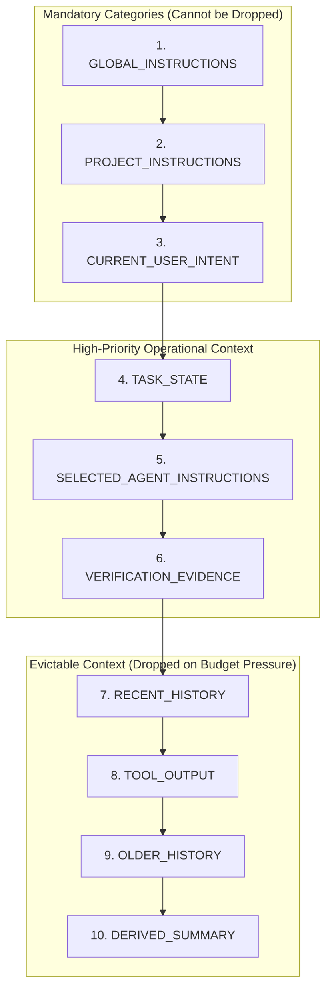
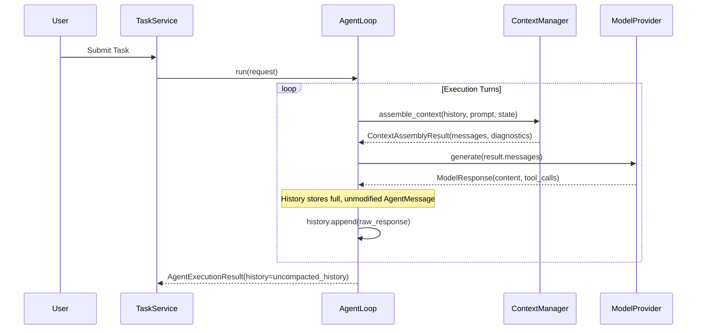

# Phase 6 Design Package — Context Management & Budgeting Subsystem

## 1. Mission & Scope

Phase 6 implements the **Context Management and Budgeting Subsystem** for the Chatbot Agent Runtime.
As established in `docs/phases.md` and research reference `2604.14228v3.pdf`, language model context windows are finite, expensive, and subject to degradation under distraction or overflow.

The mission of Phase 6 is to construct a deterministic, policy-governed runtime component that assembles model context within a bounded token budget while:
1. Reserving strict generation headroom for model responses.
2. Preserving the byte-for-byte immutable original conversation history for task records and audits.
3. Bounding tool outputs while guaranteeing that failure stack traces and process exit codes survive truncation.
4. Enforcing an explicit priority hierarchy where safety directives and current user intent can never be displaced by stale conversation logs.
5. Preventing secret leakage through context assemblies.
6. Ensuring total isolation between concurrent tasks and sessions.

```
+-----------------------------------------------------------------------------------+
|                              Deterministic Runtime                                |
|                                                                                   |
|  +--------------------+    +--------------------+    +-------------------------+  |
|  | Task State / Store |    | Durable Transcript |    | Workspace Files / Tools |  |
|  +--------------------+    +--------------------+    +-------------------------+  |
|            |                         |                            |               |
|            v                         v                            v               |
|  +-----------------------------------------------------------------------------+  |
|  |                         ContextManager.assemble_context()                   |  |
|  |  1. Secret Redaction Pipeline                                               |  |
|  |  2. Category Segregation & Priority Sort                                    |  |
|  |  3. Conservative Token Estimation (chars/3.3 + 15% safety factor)           |  |
|  |  4. Head/Tail Tool Bounding (40% head, 60% tail, explicit exit-code marker)  |  |
|  |  5. Mandatory Instruction Overflow Gate (MandatoryContextOverflowError)     |  |
|  |  6. Budget Allocation (Total - Reserve - Margin)                            |  |
|  |  7. Chronological Re-ordering for Wire Dispatch                             |  |
|  +-----------------------------------------------------------------------------+  |
|                                      |                                            |
|                                      v (Volatile Ephemeral View)                  |
|                        +---------------------------+                              |
|                        |   ModelProvider.generate  |                              |
|                        +---------------------------+                              |
+-----------------------------------------------------------------------------------+
```

---

## 2. Reference Architecture & Lessons from `2604.14228v3.pdf`

The research reference `2604.14228v3.pdf` provides critical architectural principles for context management:

1. **Deterministic Harness vs. Model Reasoning (§2 & §3.6):**
   The model reasons and proposes actions; the deterministic harness assembles context, controls budgets, enforces permissions, and truncates outputs. The model must never decide what enters its own context window without harness validation.

2. **Context Window Degradation & Distraction (§7.1):**
   Unbounded context expansion degrades reasoning fidelity. Simply stuffing complete files or entire test suites into context dilutes attention and risks context exhaustion. Active pruning and bounding are non-negotiable.

3. **Tool Output Bounding with Failure Preservation (§7.2):**
   Tools often produce megabytes of output (e.g., recursive test sweeps, build outputs). Truncating naively from the tail destroys the exact compiler errors or exception traces needed for remediation. Truncating from the head destroys initial configuration or invocation parameters. A hybrid head/tail strategy preserving diagnostics is essential.

4. **Transcript Immutability vs. Ephemeral Context Views (§7.3 & §9.1):**
   A compacted or bounded context view passed to the model is purely volatile. The persistent task transcript must remain uncompacted and byte-for-byte complete. Lossy compression must never corrupt the durable system of record.

5. **Failure & Observability Gap (§12 & §13.1):**
   Silent dropping of instructions or truncations causes insidious agent failures. Every truncation, dropped category, and token estimate must be recorded in structured diagnostics.

---

## 3. Category Taxonomy & Priority Hierarchy

Context elements are strictly partitioned into 10 distinct categories with explicit numerical priorities (lower integer = higher priority):

| Priority | Category Enum | Description | Displacement Policy |
| :---: | :--- | :--- | :--- |
| **1** | `GLOBAL_INSTRUCTIONS` | System-wide immutable constitution, safety rules, execution policies | **Mandatory** — Never dropped |
| **2** | `PROJECT_INSTRUCTIONS` | Root and nested `AGENTS.md` and repository guidelines | **Mandatory** — Never dropped |
| **3** | `CURRENT_USER_INTENT` | Active user prompt and instructions for the current turn | **Mandatory** — Never dropped |
| **4** | `TASK_STATE` | Current lifecycle state, task IDs, iteration counts, active constraints | Non-mandatory, prioritized |
| **5** | `SELECTED_AGENT_INSTRUCTIONS` | Specialist role definitions and scoped operational briefs | Non-mandatory, prioritized |
| **6** | `VERIFICATION_EVIDENCE` | Test pass/fail assertions, file diffs, approval receipts, audit evidence | Eviction-resistant |
| **7** | `RECENT_HISTORY` | Recent conversational turns (within the immediate interaction window) | Retained chronologically |
| **8** | `TOOL_OUTPUT` | Bounded tool execution results (stdout, stderr, directory listings) | Bounded to budget cap |
| **9** | `OLDER_HISTORY` | Prior conversational turns beyond the immediate recent window | Evicted on budget pressure |
| **10** | `DERIVED_SUMMARY` | Compacted summaries of historical context; marked as derived data | Evicted first on pressure |



---

## 4. Mathematical Budgeting Model & Headroom Reservation

Let:
- $M_{\text{ctx}}$ = Total configured model context window in tokens (`total_context_tokens`, e.g., 32,768).
- $M_{\text{out}}$ = Reserved completion headroom in tokens (`reserved_output_tokens`, e.g., 2,048).
- $M_{\text{margin}}$ = Safety buffer tokens (`safety_margin_tokens`, e.g., 512).
- $B_{\text{input}}$ = Effective allowable input token budget.

The input budget is strictly bounded by:
$$B_{\text{input}} = M_{\text{ctx}} - M_{\text{out}} - M_{\text{margin}}$$

### Overflow Conditions
Let $T_{\text{mand}}$ be the estimated tokens consumed by mandatory categories (`GLOBAL_INSTRUCTIONS`, `PROJECT_INSTRUCTIONS`, `CURRENT_USER_INTENT`):
$$T_{\text{mand}} = \sum_{c \in \text{Mandatory}} \text{estimate}(c)$$

If $T_{\text{mand}} > B_{\text{input}}$, the system halts immediately and raises `MandatoryContextOverflowError`.
The runtime **never** silently truncates or drops mandatory instructions to fit within budget.

---

## 5. Token Estimation Strategy & Conservative Margin

Exact tokenization requires model-specific BPE/tiktoken tokenizers that introduce heavy dependencies and C-extension vulnerabilities. As mandated by `docs/phases.md` §2 and §7.7, character counts must **never** be claimed to be exact tokens.

We implement a mathematically conservative heuristic with an explicit safety factor:
$$\text{estimate}(s) = \left\lceil \left( \frac{\text{len}(s)}{3.3} + 4 \right) \times 1.15 \right\rceil$$

### Conservative Justification:
- English prose averages ~4.0 chars/token.
- Source code, indentation, JSON syntax, and special delimiters average ~3.0–3.5 chars/token.
- Dividing by $3.3$ provides an aggressive baseline overestimate.
- The fixed $+4$ accounts for framing, delimiter tokens, and role markers.
- The $15\%$ multiplier ($1.15$) absorbs multi-byte UTF-8, punctuation clustering, and variable-length identifiers.
- Diagnostics explicitly label this metric as `estimated_tokens` with `estimator_type="conservative_heuristic_v1"`.

---

## 6. Tool Output Bounding & Failure Trace Preservation

Tool outputs (stdout, stderr, file listings) are bounded to a maximum token threshold $T_{\text{tool\_max}}$ (`context_max_tool_output_tokens`, default 1,000 tokens $\approx$ 3,300 chars).

When raw output exceeds the threshold:
1. It is divided into **40% head** (initial context, command invocation) and **60% tail** (final assertions, stack traces, exit codes).
2. A deterministic truncation marker is inserted between head and tail:
   `\n\n... [Output truncated from {orig_len} chars to {bounded_len} chars; exit_code={exit_code}] ...\n\n`
3. If an `exit_code` or `stderr` is present, it is explicitly injected into the truncation marker and tail to guarantee visibility to the model.

---

## 7. Secret Redaction Pipeline

Before any context item is admitted into an assembly, it passes through the centralized secret redaction regex filter:
- API Keys (`sk-ant-...`, `sk-proj-...`, `sk-[a-zA-Z0-9_\-]{20,}`).
- Generic tokens and bearer tokens (`ghp_...`, `Bearer ...`).
- Passwords and connection secrets.
- Values matched by configured custom secret strings.

Matched tokens are replaced with `[REDACTED_SECRET]`. Redaction is performed in-place on the context view without corrupting the execution environment.

---

## 8. Immutable Transcript vs. Volatile Request View



The `AgentExecutionResult.history` always retains the full uncompressed message sequence. Bounding, omission, and pruning are strictly ephemeral operations applied during `assemble_context()`.

---

## 9. Exception Hierarchy & Error Semantics

All context errors inherit from `core.context_models.ContextError`:
- `ContextError` (base)
  - `MandatoryContextOverflowError`: Raised when mandatory categories exceed input budget.
  - `InvalidBudgetConfigurationError`: Raised when total context $\le$ reserve + margin.
  - `MalformedContextItemError`: Raised when an item lacks content or has invalid attributes.
  - `ContextAssemblyError`: Raised on unexpected assembly failures.

---

## 10. Concurrency & Isolation Model

- `ContextManager` instances are stateless and thread-safe.
- Concurrent tasks have isolated task IDs, isolated histories, and isolated state dictionaries.
- Verification tests prove that multi-threaded simultaneous assemblies in a thread pool produce zero cross-contamination.
