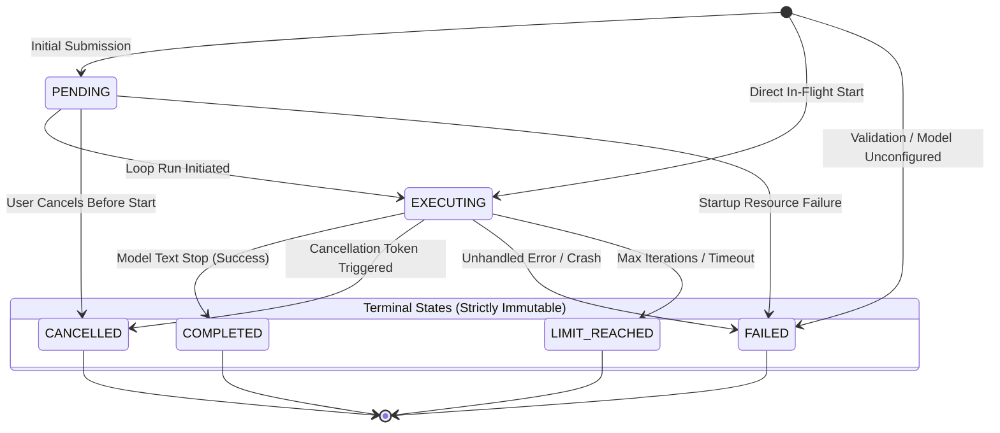
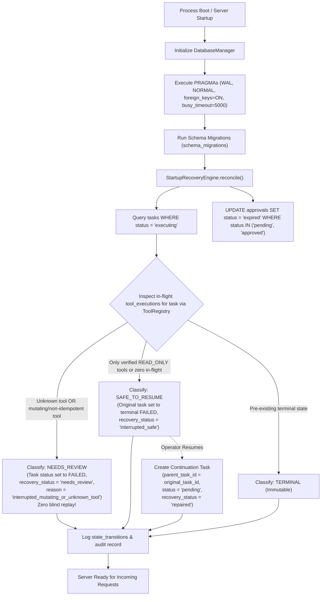
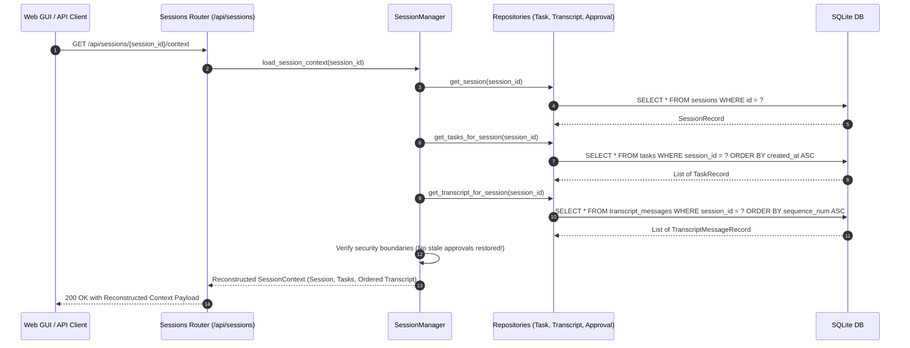

# Phase 7 — Persistent State & Session Recovery Design Specification

**Status:** Approved Design Package  
**Target Environment:** Windows 11 + PowerShell + SQLite3  
**Architecture Reference:** `2604.14228v3.pdf` (§2, §3, §3.6, §5, §7, §8, §9.1, §9.2, §10.2, §12)  
**Parent Specifications:** `docs/phases.md` (Phase 7), `AGENTS.md`  

---

## 1. Architectural Mission & Principles

Phase 7 introduces durable, authoritative persistence and safe session recovery into the Chatbot Agent Runtime.
As established in `2604.14228v3.pdf`:
- §9.1 (*Transcript Model*): Live context in working memory cannot outlive process execution or unbounded context growth. Durable state records the history of actions, decisions, and outcomes.
- §9.2 (*Resume, Fork, and Not Restoring Permissions*): Session resumption must never restore stale security grants into a changed context. Any interrupted or restarted execution must enforce deny-first authorization.
- §10.2 (*Hermes Comparison*): Observes Hermes Agent's choice of WAL-mode SQLite for transactional local state. While §10.2 documents this as one specific system's architectural pattern rather than a universal mandate for all agent runtimes, this project deliberately adopts WAL-mode SQLite based on our local runtime requirements (zero external service dependencies, ACID transactions, non-blocking concurrent readers, single-file deployment, and local developer ergonomics).
- §12.3 (*Architectural Trade-offs*): Safety must take precedence over convenience. Non-idempotent operations whose outcome is unknown across a crash boundary must never be blindly replayed.

### Core Invariants

1. **SQLite as Single Authoritative Truth:** In-memory objects (`_tasks`, `ContextManager`) are volatile working projections. Durable state resides in SQLite with `PRAGMA journal_mode = WAL`, `PRAGMA synchronous = NORMAL`, `PRAGMA foreign_keys = ON`, and `PRAGMA busy_timeout = 5000`.
2. **Terminal State & Full-Row Immutability:** Once a task reaches a terminal state (`completed`, `cancelled`, `failed`, `limit_reached`), the entire row is completely immutable. Attempted updates to ANY column (`status`, `prompt`, `error`, `response_text`, `recovery_status`, `termination_reason`, `parent_task_id`, etc.) are aborted by SQLite engine trigger `trg_prevent_terminal_task_update`.
3. **Crash Boundary Classification:** Interrupted tasks (`executing` at server startup) are deterministically classified:
   - `SAFE_TO_RESUME`: No in-flight mutating tool executions; prior context is intact.
   - `NEEDS_REVIEW`: A non-idempotent tool execution (e.g., `write_file`, `execute_command`) or an unverified tool was in-flight (`started`) when the crash occurred; the state of external systems is indeterminate, so automatic replay is strictly prohibited.
   - `FAILED`: Unrecoverable errors or explicit failure boundaries.
   - `TERMINAL`: Tasks that already committed a terminal transition before interruption.
4. **Zero Stale Approvals Across Process Restart:** All authorizations in `status IN ('pending', 'approved')` are marked `expired` across process restarts. Stale authorization tokens cannot be consumed. All six lifecycle states are preserved or transitioned deterministically.
5. **Defense-in-Depth Secret Sanitization:** Tested credential patterns (API keys, GitHub PATs, Bearer tokens, passwords) are scrubbed and redacted prior to writing records to disk across all tables as a defense-in-depth sanitization measure.

---

## 2. Mermaid Architectural Diagrams

### Diagram 1: Persistence Write Flow
Shows how state changes flow from user prompt through `TaskService`, `AgentLoop`, tool executions, and the persistence engine into SQLite.

```mermaid
flowchart TD
    User["User / Web GUI"] -->|Submit Prompt| API["FastAPI Route (/api/tasks)"]
    API -->|Submit Task| TS["TaskService"]
    
    subgraph StorageEngine ["SQLite Storage Subsystem (WAL Mode)"]
        DBConn["DatabaseManager (WAL, FK=ON)"]
        TBL_SESS["sessions"]
        TBL_TASK["tasks"]
        TBL_TRANS["state_transitions"]
        TBL_MSG["transcript_messages"]
        TBL_TOOL["tool_executions"]
        TBL_MODEL["model_calls"]
        TBL_APP["approvals"]
    end
    
    TS -->|Atomic Insert| DBConn
    DBConn --> TBL_SESS
    DBConn --> TBL_TASK
    DBConn --> TBL_TRANS
    
    TS -->|Run Turn| AL["AgentLoop"]
    
    AL -->|Assemble Context| CM["ContextManager (In-Memory Projection)"]
    AL -->|Record Turn Message| DBConn
    DBConn --> TBL_MSG
    
    AL -->|Call Model Provider| MP["Model Provider (vLLM)"]
    MP -->|Return Completion| AL
    AL -->|Log Model Metrics| DBConn
    DBConn --> TBL_MODEL
    
    AL -->|Tool Calls Proposed| TD["ToolDispatcher"]
    TD -->|Check Policy| PM["PermissionEngine"]
    
    alt Approval Required
        PM -->|Raise Request| AM["ApprovalManager"]
        AM -->|Record Pending| DBConn
        DBConn --> TBL_APP
    else Allowed
        TD -->|Pre-Tool Log 'started'| DBConn
        DBConn --> TBL_TOOL
        TD -->|Execute Tool| Tool["Tool Implementation"]
        Tool -->|Result Envelope| TD
        TD -->|Post-Tool Log 'completed' or 'failed'| DBConn
        DBConn --> TBL_TOOL
    end
    
    AL -->|Turn Completed| TS
    TS -->|Atomic State Transition| DBConn
    DBConn --> TBL_TASK
    DBConn --> TBL_TRANS
```

---

### Diagram 2: Task-State Transition Flow
Enforces linearizable state transitions, rejecting invalid hops and preserving terminal state immutability.



---

### Diagram 3: Startup Recovery Flow
Demonstrates the deterministic reconciliation algorithm that inspects disk state on application startup.



---

### Diagram 4: Tool-Call Lifecycle & Crash-Boundary Flow
Illustrates tool execution boundaries, pre-logging, post-logging, and deterministic recovery classification when a crash occurs.

```mermaid
sequenceDiagram
    autonumber
    participant Loop as AgentLoop
    participant Repo as ToolExecutionRepository
    participant DB as SQLite DB
    participant Disp as ToolDispatcher
    participant Tool as Tool (e.g. write_file / bash)

    Loop->>Repo: record_execution_started(call_id, tool, args, is_mutation, idempotent)
    Note over Repo: Scrub secrets from arguments
    Repo->>DB: INSERT INTO tool_executions (state='started', is_mutation, ...)
    
    alt CRASH BEFORE DISPATCH
        Note over DB: State remains 'started'. On recovery: inspect tool type.<br/>If mutating -> NEEDS_REVIEW.
    end
    
    Loop->>Disp: dispatch(call_id, tool, args)
    Disp->>Tool: execute()
    
    alt CRASH DURING EXECUTION
        Note over Tool: Subprocess or file write killed abruptly.<br/>Outcome on host disk is unknown!
        Note over DB: Tool state is still 'started'.<br/>On restart: Classified as NEEDS_REVIEW.<br/>NEVER blindly replay!
    end
    
    Tool-->>Disp: ToolResultEnvelope (success, output, error)
    Disp-->>Loop: ToolResultEnvelope
    
    Loop->>Repo: record_execution_completed(call_id, state='completed', output, exit_code)
    Note over Repo: Scrub secrets from output
    Repo->>DB: UPDATE tool_executions SET state='completed', output=...
    
    alt CRASH AFTER TOOL COMMIT
        Note over DB: Tool is cleanly recorded as 'completed'.<br/>On restart: Safe to resume or review prior results!
    end
```

---

### Diagram 5: Session Reconstruction Flow
Details how a session is safely loaded and reconstructed from durable SQLite storage for inspection or continuation.



---

## 3. Relational Database Schema Specification

The schema is defined in versioned SQL migrations (`001_initial_schema.sql`):

```sql
-- Migration tracking table
CREATE TABLE IF NOT EXISTS schema_migrations (
    version INTEGER PRIMARY KEY,
    description TEXT NOT NULL,
    applied_at TEXT NOT NULL
);

-- Sessions table
CREATE TABLE IF NOT EXISTS sessions (
    id TEXT PRIMARY KEY,
    title TEXT NOT NULL,
    workspace_path TEXT NOT NULL,
    status TEXT NOT NULL CHECK(status IN ('active', 'completed', 'archived')),
    metadata_json TEXT DEFAULT '{}',
    created_at TEXT NOT NULL,
    updated_at TEXT NOT NULL
);

-- Tasks table
CREATE TABLE IF NOT EXISTS tasks (
    id TEXT PRIMARY KEY,
    session_id TEXT REFERENCES sessions(id) ON DELETE SET NULL,
    prompt TEXT NOT NULL,
    status TEXT NOT NULL CHECK(status IN ('pending', 'executing', 'completed', 'failed', 'cancelled', 'limit_reached')),
    recovery_status TEXT DEFAULT NULL CHECK(recovery_status IN (NULL, 'clean', 'interrupted_safe', 'needs_review', 'repaired')),
    response_text TEXT DEFAULT NULL,
    finish_reason TEXT DEFAULT NULL,
    model TEXT DEFAULT NULL,
    usage_json TEXT DEFAULT NULL,
    error TEXT DEFAULT NULL,
    iterations INTEGER DEFAULT 0,
    tool_calls_count INTEGER DEFAULT 0,
    termination_reason TEXT DEFAULT NULL,
    created_at TEXT NOT NULL,
    started_at TEXT DEFAULT NULL,
    completed_at TEXT DEFAULT NULL,
    version INTEGER DEFAULT 1
);

-- State transitions audit log
CREATE TABLE IF NOT EXISTS state_transitions (
    id TEXT PRIMARY KEY,
    entity_type TEXT NOT NULL,
    entity_id TEXT NOT NULL,
    from_state TEXT NOT NULL,
    to_state TEXT NOT NULL,
    reason TEXT DEFAULT NULL,
    actor TEXT NOT NULL DEFAULT 'runtime',
    created_at TEXT NOT NULL
);

-- Transcript messages
CREATE TABLE IF NOT EXISTS transcript_messages (
    id TEXT PRIMARY KEY,
    session_id TEXT REFERENCES sessions(id) ON DELETE CASCADE,
    task_id TEXT REFERENCES tasks(id) ON DELETE CASCADE,
    sequence_num INTEGER NOT NULL,
    role TEXT NOT NULL CHECK(role IN ('system', 'user', 'assistant', 'tool')),
    content TEXT DEFAULT NULL,
    name TEXT DEFAULT NULL,
    tool_call_id TEXT DEFAULT NULL,
    tool_calls_json TEXT DEFAULT NULL,
    is_derived INTEGER DEFAULT 0,
    created_at TEXT NOT NULL
);

-- Tool executions
CREATE TABLE IF NOT EXISTS tool_executions (
    id TEXT PRIMARY KEY,
    task_id TEXT NOT NULL REFERENCES tasks(id) ON DELETE CASCADE,
    call_id TEXT NOT NULL,
    tool_name TEXT NOT NULL,
    arguments_json TEXT NOT NULL,
    execution_state TEXT NOT NULL CHECK(execution_state IN ('requested', 'started', 'completed', 'failed', 'interrupted')),
    is_mutation INTEGER NOT NULL DEFAULT 0,
    idempotent INTEGER NOT NULL DEFAULT 0,
    exit_code INTEGER DEFAULT NULL,
    result_output TEXT DEFAULT NULL,
    error TEXT DEFAULT NULL,
    error_category TEXT DEFAULT NULL,
    duration_ms REAL DEFAULT NULL,
    created_at TEXT NOT NULL,
    started_at TEXT DEFAULT NULL,
    completed_at TEXT DEFAULT NULL
);

-- Model calls
CREATE TABLE IF NOT EXISTS model_calls (
    id TEXT PRIMARY KEY,
    task_id TEXT NOT NULL REFERENCES tasks(id) ON DELETE CASCADE,
    iteration INTEGER NOT NULL,
    model TEXT NOT NULL,
    prompt_tokens INTEGER DEFAULT 0,
    completion_tokens INTEGER DEFAULT 0,
    total_tokens INTEGER DEFAULT 0,
    finish_reason TEXT DEFAULT NULL,
    latency_ms REAL DEFAULT NULL,
    created_at TEXT NOT NULL
);

-- Approvals
CREATE TABLE IF NOT EXISTS approvals (
    id TEXT PRIMARY KEY,
    task_id TEXT NOT NULL REFERENCES tasks(id) ON DELETE CASCADE,
    call_id TEXT NOT NULL,
    tool_name TEXT NOT NULL,
    risk_category TEXT NOT NULL,
    action_hash TEXT NOT NULL,
    status TEXT NOT NULL CHECK(status IN ('pending', 'approved', 'denied', 'expired', 'cancelled', 'consumed')),
    reason TEXT NOT NULL,
    decision_reason TEXT DEFAULT NULL,
    requested_at TEXT NOT NULL,
    expires_at TEXT NOT NULL,
    decided_at TEXT DEFAULT NULL
);

-- Performance and query indexes
CREATE INDEX IF NOT EXISTS idx_tasks_session_id ON tasks(session_id);
CREATE INDEX IF NOT EXISTS idx_tasks_status ON tasks(status);
CREATE INDEX IF NOT EXISTS idx_state_transitions_entity ON state_transitions(entity_type, entity_id);
CREATE INDEX IF NOT EXISTS idx_transcript_session_seq ON transcript_messages(session_id, sequence_num);
CREATE INDEX IF NOT EXISTS idx_transcript_task ON transcript_messages(task_id);
CREATE INDEX IF NOT EXISTS idx_tool_executions_task ON tool_executions(task_id);
CREATE INDEX IF NOT EXISTS idx_tool_executions_call ON tool_executions(call_id);
CREATE INDEX IF NOT EXISTS idx_tool_executions_state ON tool_executions(execution_state);
CREATE INDEX IF NOT EXISTS idx_model_calls_task ON model_calls(task_id);
CREATE INDEX IF NOT EXISTS idx_approvals_task ON approvals(task_id);
CREATE INDEX IF NOT EXISTS idx_approvals_status ON approvals(status);
```

### Migration 002: Triggers and Continuations (`002_immutability_triggers_and_continuations`)

```sql
-- Migration 002: Immutability triggers and task continuations

-- Add parent_task_id column to tasks table for lineage tracking and safe resumption
ALTER TABLE tasks ADD COLUMN parent_task_id TEXT REFERENCES tasks(id) ON DELETE SET NULL;

-- Unique partial index enforcing AT MOST ONE continuation task per parent task at the database engine level
CREATE UNIQUE INDEX IF NOT EXISTS uq_tasks_parent_task ON tasks(parent_task_id) WHERE parent_task_id IS NOT NULL;

-- Trigger 1: Engine-level enforcement of FULL-ROW terminal task immutability
DROP TRIGGER IF EXISTS trg_prevent_terminal_task_status_update;
CREATE TRIGGER IF NOT EXISTS trg_prevent_terminal_task_update
BEFORE UPDATE ON tasks
FOR EACH ROW
WHEN OLD.status IN ('completed', 'cancelled', 'failed', 'limit_reached')
BEGIN
    SELECT RAISE(ABORT, 'Illegal database state transition: terminal tasks (completed, cancelled, failed, limit_reached) are completely immutable');
END;

-- Trigger 2: Engine-level enforcement of valid transitions from PENDING
CREATE TRIGGER IF NOT EXISTS trg_prevent_illegal_pending_transition
BEFORE UPDATE OF status ON tasks
FOR EACH ROW
WHEN OLD.status = 'pending' AND NEW.status NOT IN ('executing', 'cancelled', 'failed')
BEGIN
    SELECT RAISE(ABORT, 'Illegal database state transition: pending tasks may only transition to executing, cancelled, or failed');
END;

-- Trigger 3: Engine-level enforcement of valid transitions from EXECUTING
CREATE TRIGGER IF NOT EXISTS trg_prevent_illegal_executing_transition
BEFORE UPDATE OF status ON tasks
FOR EACH ROW
WHEN OLD.status = 'executing' AND NEW.status NOT IN ('completed', 'failed', 'cancelled', 'limit_reached')
BEGIN
    SELECT RAISE(ABORT, 'Illegal database state transition: executing tasks may only transition to terminal states');
END;
```

---

## 4. Remediation & Operational Invariants (Findings F7-01 to F7-06 & Refinements)

### 4.1 F7-01, Issue 3 & Review C: Continuation Task Pattern, Concurrency Protection & Transaction Recovery
A task in terminal `FAILED` status (`recovery_status = 'interrupted_safe'`) is strictly immutable against updates. To resume execution without violating terminal immutability:
1. The interrupted task remains in `FAILED` status indefinitely, serving as an immutable historical record.
2. The operator or runtime invokes `create_continuation_task(original_task_id)` / `POST /api/tasks/{task_id}/resume`.
3. A new task record is created with:
   - `parent_task_id = original_task_id` (provenance link)
   - `session_id = original_task.session_id` (shared session history)
   - `status = 'pending'`
   - `recovery_status = 'repaired'`
   - `prompt = original_task.prompt`
4. **Concurrency Race Protection & Atomic Transaction Recovery:**
   - The database enforces a partial unique index: `uq_tasks_parent_task ON tasks(parent_task_id) WHERE parent_task_id IS NOT NULL;`.
   - If two or more simultaneous resume requests race to execute, the winning transaction commits the continuation task and its initial creation state transition.
   - Any competing transaction encounters a unique constraint violation and receives `sqlite3.IntegrityError`.
   - `DatabaseManager.transaction()` catches the exception and executes `conn.rollback()`, ensuring that no partial task records or ghost state transitions remain from the losing attempt.
   - `StartupRecoveryEngine.create_continuation_task` explicitly inspects the error message: only if the error specifically reflects the `parent_task_id` or `uq_tasks_parent_task` constraint does it resolve the race by fetching the committed winning continuation task using a fresh read query.
   - Non-uniqueness integrity errors (e.g. invalid foreign keys, CHECK violations, NOT NULL constraints) fail closed immediately and are re-raised; an `IntegrityError` is never blindly assumed to be a continuation race.
   - Database busy/locked operational errors (`sqlite3.OperationalError`) are distinguished from uniqueness integrity conflicts and re-raised cleanly.
   - Tested and proven with 10 concurrent threads simultaneously issuing resume requests: exactly ONE continuation is persisted, and all callers receive the identical task ID.
5. Attempting to resume a `NEEDS_REVIEW` task raises `ValueError`.

### 4.2 F7-02, Issue 1 & Review A: Database-Engine-Level Full-Row Update Immutability vs Deletion
Terminal state immutability is enforced at the SQLite engine level:
- `trg_prevent_terminal_task_update` runs `BEFORE UPDATE ON tasks` (not merely on `status`).
- Any raw SQL attempting to modify ANY column (`prompt`, `error`, `response_text`, `recovery_status`, `termination_reason`, `parent_task_id`, etc.) of a terminal task raises `sqlite3.IntegrityError: Illegal database state transition: terminal tasks (completed, cancelled, failed, limit_reached) are completely immutable`.
- **Update Immutability versus Administrative Deletion:**
  - The architectural invariant is that **terminal task records cannot be updated**. Once a task enters a terminal status (`completed`, `cancelled`, `failed`, `limit_reached`), no SQL `UPDATE` may alter its data.
  - Deletion is NOT exposed via the public runtime REST API.
  - Deletion exists strictly as a low-level administrative repository method (`TaskRepository.delete(task_id: str)`) for database pruning, test fixtures, or administrative maintenance.
  - When an administrative delete occurs, cascading foreign keys remove dependent execution records (`transcript_messages`, `tool_executions`, `model_calls`, `approvals`).
  - However, the `state_transitions` audit log table has NO foreign key dependency on `tasks(id)`; all linear state transition records for the task remain permanently preserved in the database, maintaining complete historical auditability.

### 4.3 F7-03 & Issue 4: Secret Sanitization Defense-in-Depth
Credential sanitization (`redact_secrets`) is applied on all database write paths:
- `tasks`: `prompt`, `error`, `response_text`, `termination_reason`
- `transcript_messages`: `content`, `tool_calls_json`
- `tool_executions`: `arguments_json`, `result_output`, `error`
- `approvals`: `reason`, `decision_reason`
- `state_transitions`: `reason`
- `sessions`: `title`, `metadata_json`
- runtime event logs: `payload`
*Defense-in-depth qualification:* Regex scrubbing provides active sanitization against tested credential patterns (Anthropic API keys, GitHub PATs, Bearer tokens, passwords). Testing verifies that known token patterns are detected and redacted on all recorded write paths; it is documented as defense-in-depth sanitization rather than an absolute guarantee against every conceivable secret format.

### 4.4 F7-04 & Review B: Versioned Migration Upgrade, Non-Destructive Deduplication & Rollback
- MigrationRunner tracks migrations sequentially in `schema_migrations`.
- Upgrading from v1 (`001_initial_schema`) to v2 (`002_immutability_triggers_and_continuations`) preserves 100% of existing rows without data loss.
- **Migration Compatibility & Non-Destructive Continuation Deduplication:**
  - `_apply_migration_002` checks `PRAGMA table_info` before executing `ALTER TABLE tasks ADD COLUMN parent_task_id`, ensuring smooth upgrades on existing databases where the column was already defined.
  - If pre-v2 data contains duplicate `parent_task_id` relationships (e.g. from historical uncoordinated concurrent continuation creation), Migration 002 preserves genuine causal lineage: the earliest primary continuation retains `parent_task_id = P`, while subsequent concurrent duplicate attempts have `parent_task_id` set to `NULL` (detached), recording state transition audit records with full provenance. This prevents manufacturing a false causal parent-child hierarchy between concurrent sibling tasks while strictly satisfying the partial unique index (`WHERE parent_task_id IS NOT NULL`).
  - **Zero historical task records or transcripts are deleted** to make the migration pass.
  - Tested across:
    1. Clean v1 schema database.
    2. v2 database with no continuation records (idempotent).
    3. Database with valid continuation records (all preserved).
    4. Database with duplicate continuation relationships (100% records preserved, genuine causal lineage preserved, unique index active).
- In-flight migration failures abort via transactional rollback, leaving the schema clean without orphan tables.

### 4.5 F7-05: Runtime-Owned Tool Classification Authority
Tool safety classification during startup recovery is governed by the active runtime `ToolRegistry`, not database records:
- Unregistered/unknown tools (including external or MCP tools) default fail-closed to `NEEDS_REVIEW`.
- Even if a database record has `is_mutation=0` or `idempotent=1`, the tool is classified as `SAFE_TO_RESUME` only if `ToolRegistry.get(tool_name).risk_category == ToolRiskCategory.READ_ONLY`.
- Mutating tools (`workspace_write`, `command_execution`, `destructive`) with forged or corrupted DB flags are overridden to `NEEDS_REVIEW`.

### 4.6 F7-06 & Issue 2: Complete 6-State Approval Lifecycle Across Restart
The schema permits six approval states: `pending`, `approved`, `denied`, `expired`, `cancelled`, `consumed`.
Per `2604.14228v3.pdf` §5 and §9.2:
- On startup, `StartupRecoveryEngine` executes:
  `UPDATE approvals SET status = 'expired', decision_reason = 'Invalidated on process_restart' WHERE status IN ('pending', 'approved');`
- Unconsumed `approved` tokens and `pending` tokens expire immediately.
- Terminal resolution states remain immutable and preserved:
  - `consumed`: preserved, cannot be re-consumed.
  - `denied`: preserved, cannot be consumed.
  - `expired`: preserved, cannot be consumed.
  - `cancelled`: preserved (e.g. task cancelled by user/runtime), cannot be consumed (`consume_token` returns `False`).

---

## 4. Software Boundaries and Module Structure

```
storage/
├── __init__.py                # Module exports
├── database.py                # DatabaseManager, Connection Factory, WAL pragma setup, transactions
├── migrations.py              # Versioned migration engine and schema definitions
├── models.py                  # Pydantic & typed records for persistence entities
├── repositories.py            # SessionRepository, TaskRepository, TranscriptRepository, ToolExecutionRepository, etc.
core/
├── recovery.py                # StartupRecoveryEngine: crash boundary detection & reconciliation
├── session_manager.py         # High-level session lifecycle and reconstruction
```

This design integrates directly with existing components:
- `core/config.py`: Adds persistence configuration options (`DATABASE_URL`, `DATABASE_BUSY_TIMEOUT_MS`, `DATABASE_WAL_MODE`).
- `core/task_service.py`: Integrates `DatabaseManager` and repositories for atomic state updates and persistence.
- `core/agent_loop.py`: Logs tool executions, model calls, and transcript turns to storage repositories.
- `api/routes/sessions.py`: Exposes REST endpoints for session listing, inspection, and resumption.
