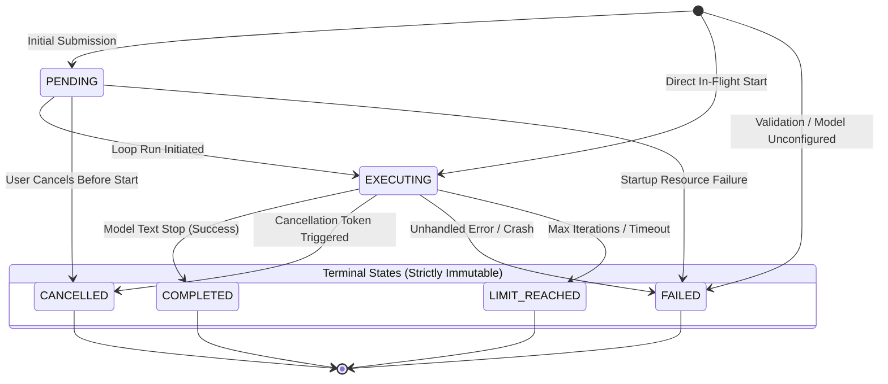
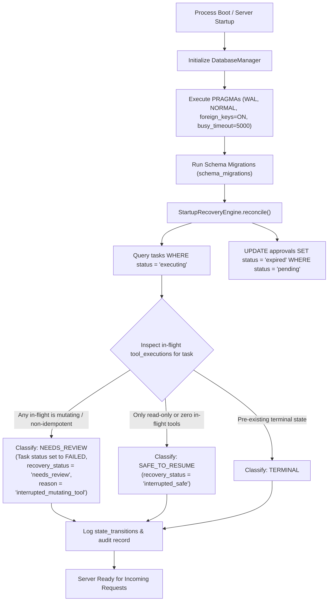
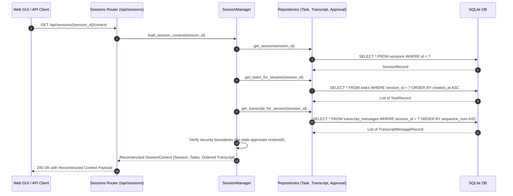

# Phase 7 — Persistent State & Session Recovery Design Specification

**Status:** Approved Design Package  
**Target Environment:** Windows 11 + PowerShell + SQLite3  
**Architecture Reference:** `2604.14228v3.pdf` (§2, §3, §3.6, §5, §7, §8, §9.1, §9.2, §10.2, §12)  
**Parent Specifications:** `docs/phases.md` (Phase 7), `AGENTS.md`  

---

## 1. Architectural Mission & Principles

Phase 7 introduces durable, authoritative persistence and safe session recovery into the Chatbot Agent Runtime.
As established in `2604.14228v3.pdf`:
- §9.1 (*Transcript Model*): Live context in working memory cannot outlive process execution or unbounded context growth. Durable state records the history of actions, decisions, and outcomes.
- §9.2 (*Resume, Fork, and Not Restoring Permissions*): Session resumption must never restore stale security grants into a changed context. Any interrupted or restarted execution must enforce deny-first authorization.
- §10.2 (*Hermes Comparison*): A WAL-mode SQLite database provides transactional ACID guarantees, relational indexing, cross-session search, and concurrent-reader support without external service dependencies.
- §12.3 (*Architectural Trade-offs*): Safety must take precedence over convenience. Non-idempotent operations whose outcome is unknown across a crash boundary must never be blindly replayed.

### Core Invariants

1. **SQLite as Single Authoritative Truth:** In-memory objects (`_tasks`, `ContextManager`) are volatile working projections. Durable state resides in SQLite with `PRAGMA journal_mode = WAL`, `PRAGMA synchronous = NORMAL`, `PRAGMA foreign_keys = ON`, and `PRAGMA busy_timeout = 5000`.
2. **Terminal State Immutability:** Once a task reaches a terminal state (`completed`, `cancelled`, `failed`, `limit_reached`), it cannot be transitioned to any other state. Attempted mutations are rejected at both database constraint and application service layers.
3. **Crash Boundary Classification:** Interrupted tasks (`executing` at server startup) are deterministically classified:
   - `SAFE_TO_RESUME`: No in-flight mutating tool executions; prior context is intact.
   - `NEEDS_REVIEW`: A non-idempotent tool execution (e.g., `write_file`, `execute_command`) was in-flight (`started`) when the crash occurred; the state of external systems is indeterminate, so automatic replay is strictly prohibited.
   - `FAILED`: Unrecoverable errors or explicit failure boundaries.
   - `TERMINAL`: Tasks that already committed a terminal transition before interruption.
4. **Zero Stale Approvals:** All approvals left `pending` across process restarts are immediately marked `expired`. No authorization token survives process termination.
5. **Secret-Free Persistence Boundary:** All credentials, API keys, and sensitive tokens are scrubbed and redacted prior to writing records to disk.

---

## 2. Mermaid Architectural Diagrams

### Diagram 1: Persistence Write Flow
Shows how state changes flow from user prompt through `TaskService`, `AgentLoop`, tool executions, and the persistence engine into SQLite.

```mermaid
flowchart TD
    User["User / Web GUI"] -->|Submit Prompt| API["FastAPI Route (/api/tasks)"]
    API -->|Submit Task| TS["TaskService"]
    
    subgraph StorageEngine ["SQLite Storage Subsystem (WAL Mode)"]
        DBConn["DatabaseManager (WAL, FK=ON)"]
        TBL_SESS["sessions"]
        TBL_TASK["tasks"]
        TBL_TRANS["state_transitions"]
        TBL_MSG["transcript_messages"]
        TBL_TOOL["tool_executions"]
        TBL_MODEL["model_calls"]
        TBL_APP["approvals"]
    end
    
    TS -->|Atomic Insert| DBConn
    DBConn --> TBL_SESS
    DBConn --> TBL_TASK
    DBConn --> TBL_TRANS
    
    TS -->|Run Turn| AL["AgentLoop"]
    
    AL -->|Assemble Context| CM["ContextManager (In-Memory Projection)"]
    AL -->|Record Turn Message| DBConn
    DBConn --> TBL_MSG
    
    AL -->|Call Model Provider| MP["Model Provider (vLLM)"]
    MP -->|Return Completion| AL
    AL -->|Log Model Metrics| DBConn
    DBConn --> TBL_MODEL
    
    AL -->|Tool Calls Proposed| TD["ToolDispatcher"]
    TD -->|Check Policy| PM["PermissionEngine"]
    
    alt Approval Required
        PM -->|Raise Request| AM["ApprovalManager"]
        AM -->|Record Pending| DBConn
        DBConn --> TBL_APP
    else Allowed
        TD -->|Pre-Tool Log 'started'| DBConn
        DBConn --> TBL_TOOL
        TD -->|Execute Tool| Tool["Tool Implementation"]
        Tool -->|Result Envelope| TD
        TD -->|Post-Tool Log 'completed' or 'failed'| DBConn
        DBConn --> TBL_TOOL
    end
    
    AL -->|Turn Completed| TS
    TS -->|Atomic State Transition| DBConn
    DBConn --> TBL_TASK
    DBConn --> TBL_TRANS
```

---

### Diagram 2: Task-State Transition Flow
Enforces linearizable state transitions, rejecting invalid hops and preserving terminal state immutability.



---

### Diagram 3: Startup Recovery Flow
Demonstrates the deterministic reconciliation algorithm that inspects disk state on application startup.



---

### Diagram 4: Tool-Call Lifecycle & Crash-Boundary Flow
Illustrates tool execution boundaries, pre-logging, post-logging, and deterministic recovery classification when a crash occurs.

```mermaid
sequenceDiagram
    autonumber
    participant Loop as AgentLoop
    participant Repo as ToolExecutionRepository
    participant DB as SQLite DB
    participant Disp as ToolDispatcher
    participant Tool as Tool (e.g. write_file / bash)

    Loop->>Repo: record_execution_started(call_id, tool, args, is_mutation, idempotent)
    Note over Repo: Scrub secrets from arguments
    Repo->>DB: INSERT INTO tool_executions (state='started', is_mutation, ...)
    
    alt CRASH BEFORE DISPATCH
        Note over DB: State remains 'started'. On recovery: inspect tool type.<br/>If mutating -> NEEDS_REVIEW.
    end
    
    Loop->>Disp: dispatch(call_id, tool, args)
    Disp->>Tool: execute()
    
    alt CRASH DURING EXECUTION
        Note over Tool: Subprocess or file write killed abruptly.<br/>Outcome on host disk is unknown!
        Note over DB: Tool state is still 'started'.<br/>On restart: Classified as NEEDS_REVIEW.<br/>NEVER blindly replay!
    end
    
    Tool-->>Disp: ToolResultEnvelope (success, output, error)
    Disp-->>Loop: ToolResultEnvelope
    
    Loop->>Repo: record_execution_completed(call_id, state='completed', output, exit_code)
    Note over Repo: Scrub secrets from output
    Repo->>DB: UPDATE tool_executions SET state='completed', output=...
    
    alt CRASH AFTER TOOL COMMIT
        Note over DB: Tool is cleanly recorded as 'completed'.<br/>On restart: Safe to resume or review prior results!
    end
```

---

### Diagram 5: Session Reconstruction Flow
Details how a session is safely loaded and reconstructed from durable SQLite storage for inspection or continuation.



---

## 3. Relational Database Schema Specification

The schema is defined in versioned SQL migrations (`001_initial_schema.sql`):

```sql
-- Migration tracking table
CREATE TABLE IF NOT EXISTS schema_migrations (
    version INTEGER PRIMARY KEY,
    description TEXT NOT NULL,
    applied_at TEXT NOT NULL
);

-- Sessions table
CREATE TABLE IF NOT EXISTS sessions (
    id TEXT PRIMARY KEY,
    title TEXT NOT NULL,
    workspace_path TEXT NOT NULL,
    status TEXT NOT NULL CHECK(status IN ('active', 'completed', 'archived')),
    metadata_json TEXT DEFAULT '{}',
    created_at TEXT NOT NULL,
    updated_at TEXT NOT NULL
);

-- Tasks table
CREATE TABLE IF NOT EXISTS tasks (
    id TEXT PRIMARY KEY,
    session_id TEXT REFERENCES sessions(id) ON DELETE SET NULL,
    prompt TEXT NOT NULL,
    status TEXT NOT NULL CHECK(status IN ('pending', 'executing', 'completed', 'failed', 'cancelled', 'limit_reached')),
    recovery_status TEXT DEFAULT NULL CHECK(recovery_status IN (NULL, 'clean', 'interrupted_safe', 'needs_review', 'repaired')),
    response_text TEXT DEFAULT NULL,
    finish_reason TEXT DEFAULT NULL,
    model TEXT DEFAULT NULL,
    usage_json TEXT DEFAULT NULL,
    error TEXT DEFAULT NULL,
    iterations INTEGER DEFAULT 0,
    tool_calls_count INTEGER DEFAULT 0,
    termination_reason TEXT DEFAULT NULL,
    created_at TEXT NOT NULL,
    started_at TEXT DEFAULT NULL,
    completed_at TEXT DEFAULT NULL,
    version INTEGER DEFAULT 1
);

-- State transitions audit log
CREATE TABLE IF NOT EXISTS state_transitions (
    id TEXT PRIMARY KEY,
    entity_type TEXT NOT NULL,
    entity_id TEXT NOT NULL,
    from_state TEXT NOT NULL,
    to_state TEXT NOT NULL,
    reason TEXT DEFAULT NULL,
    actor TEXT NOT NULL DEFAULT 'runtime',
    created_at TEXT NOT NULL
);

-- Transcript messages
CREATE TABLE IF NOT EXISTS transcript_messages (
    id TEXT PRIMARY KEY,
    session_id TEXT REFERENCES sessions(id) ON DELETE CASCADE,
    task_id TEXT REFERENCES tasks(id) ON DELETE CASCADE,
    sequence_num INTEGER NOT NULL,
    role TEXT NOT NULL CHECK(role IN ('system', 'user', 'assistant', 'tool')),
    content TEXT DEFAULT NULL,
    name TEXT DEFAULT NULL,
    tool_call_id TEXT DEFAULT NULL,
    tool_calls_json TEXT DEFAULT NULL,
    is_derived INTEGER DEFAULT 0,
    created_at TEXT NOT NULL
);

-- Tool executions
CREATE TABLE IF NOT EXISTS tool_executions (
    id TEXT PRIMARY KEY,
    task_id TEXT NOT NULL REFERENCES tasks(id) ON DELETE CASCADE,
    call_id TEXT NOT NULL,
    tool_name TEXT NOT NULL,
    arguments_json TEXT NOT NULL,
    execution_state TEXT NOT NULL CHECK(execution_state IN ('requested', 'started', 'completed', 'failed', 'interrupted')),
    is_mutation INTEGER NOT NULL DEFAULT 0,
    idempotent INTEGER NOT NULL DEFAULT 0,
    exit_code INTEGER DEFAULT NULL,
    result_output TEXT DEFAULT NULL,
    error TEXT DEFAULT NULL,
    error_category TEXT DEFAULT NULL,
    duration_ms REAL DEFAULT NULL,
    created_at TEXT NOT NULL,
    started_at TEXT DEFAULT NULL,
    completed_at TEXT DEFAULT NULL
);

-- Model calls
CREATE TABLE IF NOT EXISTS model_calls (
    id TEXT PRIMARY KEY,
    task_id TEXT NOT NULL REFERENCES tasks(id) ON DELETE CASCADE,
    iteration INTEGER NOT NULL,
    model TEXT NOT NULL,
    prompt_tokens INTEGER DEFAULT 0,
    completion_tokens INTEGER DEFAULT 0,
    total_tokens INTEGER DEFAULT 0,
    finish_reason TEXT DEFAULT NULL,
    latency_ms REAL DEFAULT NULL,
    created_at TEXT NOT NULL
);

-- Approvals
CREATE TABLE IF NOT EXISTS approvals (
    id TEXT PRIMARY KEY,
    task_id TEXT NOT NULL REFERENCES tasks(id) ON DELETE CASCADE,
    call_id TEXT NOT NULL,
    tool_name TEXT NOT NULL,
    risk_category TEXT NOT NULL,
    action_hash TEXT NOT NULL,
    status TEXT NOT NULL CHECK(status IN ('pending', 'approved', 'denied', 'expired', 'cancelled', 'consumed')),
    reason TEXT NOT NULL,
    decision_reason TEXT DEFAULT NULL,
    requested_at TEXT NOT NULL,
    expires_at TEXT NOT NULL,
    decided_at TEXT DEFAULT NULL
);

-- Performance and query indexes
CREATE INDEX IF NOT EXISTS idx_tasks_session_id ON tasks(session_id);
CREATE INDEX IF NOT EXISTS idx_tasks_status ON tasks(status);
CREATE INDEX IF NOT EXISTS idx_state_transitions_entity ON state_transitions(entity_type, entity_id);
CREATE INDEX IF NOT EXISTS idx_transcript_session_seq ON transcript_messages(session_id, sequence_num);
CREATE INDEX IF NOT EXISTS idx_transcript_task ON transcript_messages(task_id);
CREATE INDEX IF NOT EXISTS idx_tool_executions_task ON tool_executions(task_id);
CREATE INDEX IF NOT EXISTS idx_tool_executions_call ON tool_executions(call_id);
CREATE INDEX IF NOT EXISTS idx_tool_executions_state ON tool_executions(execution_state);
CREATE INDEX IF NOT EXISTS idx_model_calls_task ON model_calls(task_id);
CREATE INDEX IF NOT EXISTS idx_approvals_task ON approvals(task_id);
CREATE INDEX IF NOT EXISTS idx_approvals_status ON approvals(status);
```

---

## 4. Software Boundaries and Module Structure

```
storage/
├── __init__.py                # Module exports
├── database.py                # DatabaseManager, Connection Factory, WAL pragma setup, transactions
├── migrations.py              # Versioned migration engine and schema definitions
├── models.py                  # Pydantic & typed records for persistence entities
├── repositories.py            # SessionRepository, TaskRepository, TranscriptRepository, ToolExecutionRepository, etc.
core/
├── recovery.py                # StartupRecoveryEngine: crash boundary detection & reconciliation
├── session_manager.py         # High-level session lifecycle and reconstruction
```

This design integrates directly with existing components:
- `core/config.py`: Adds persistence configuration options (`DATABASE_URL`, `DATABASE_BUSY_TIMEOUT_MS`, `DATABASE_WAL_MODE`).
- `core/task_service.py`: Integrates `DatabaseManager` and repositories for atomic state updates and persistence.
- `core/agent_loop.py`: Logs tool executions, model calls, and transcript turns to storage repositories.
- `api/routes/sessions.py`: Exposes REST endpoints for session listing, inspection, and resumption.
