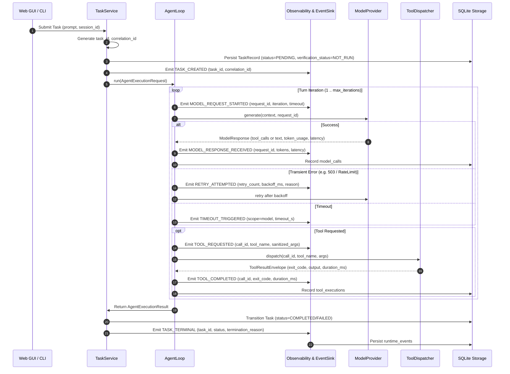
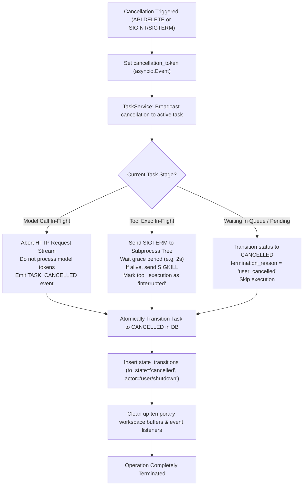
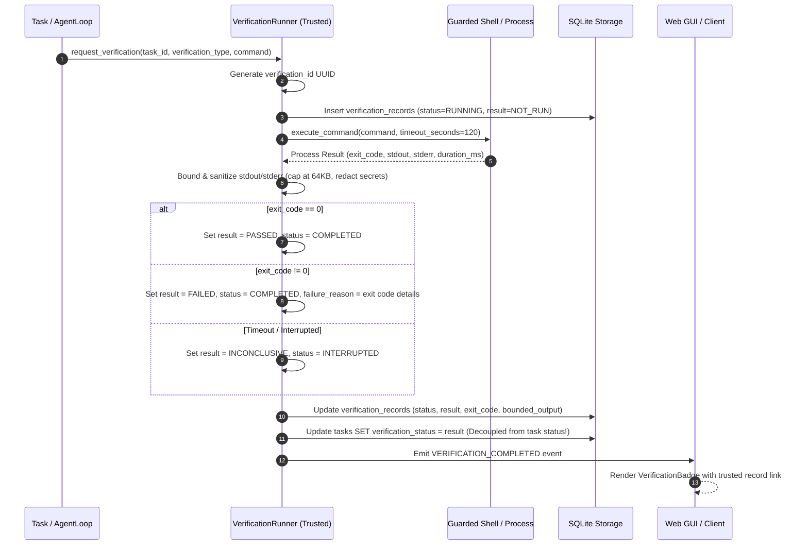

# Phase 8 — Reliability, Observability, and Verification: Architectural Design & Implementation Specification

**Phase Target:** `Phase 8 — Reliability, Observability, and Verification`  
**Status:** `DESIGN APPROVED · SPECIFICATION LOCKED`  
**Mandatory Research Reference:** `sources/2604.14228v3.pdf` (§3.2, §4.3, §4.4, §8, §9.1, §12.3, §13)  
**Parent Contract:** `docs/phases.md` (Phase 8 Specification)  
**Date:** 2026-11-15  

---

## 1. Executive Summary & Phase 7 Freeze Verification

Phase 7 (**Persistent State & Session Recovery**) is formally frozen and locked at commit `9590efd`.
- **All Forensic Findings & Review Items Verified:**
  - Full-row update immutability enforced at SQLite engine level (`trg_prevent_terminal_task_update`).
  - Administrative deletion strictly isolated to `TaskRepository.delete()` (never on public REST APIs) with non-cascading `state_transitions` audit retention.
  - Safe continuation tasks spawned via `parent_task_id` with SQLite partial unique index (`uq_tasks_parent_task`).
  - Concurrent resumption races resolved atomically with losing transaction rollback via `DatabaseManager.transaction()`.
  - Non-destructive migration deduplication preserving true causal lineage (winning continuation keeps `parent_task_id = P`; duplicate concurrent attempts detached with `parent_task_id = NULL`), avoiding the manufacture of false causal hierarchies.
  - Runtime `ToolRegistry` authority governing startup recovery classification (zero blind replay).
  - Volatile authorizations expired on restart across all 6 approval states.
  - Defense-in-depth secret sanitization verified across all persistence tables.
- **Test Baseline:** 522 passed, 1 skipped (0 failures, 0 errors in backend pytest); 55/55 passed in frontend vitest; frontend build clean in 581ms.

Phase 8 introduces **Reliability, Observability, and Verification** to elevate the runtime from basic execution to an observable, resilient, self-diagnosing, and independently verifiable production engine.

---

## 2. Phase 8 Requirement Mapping

| # | Work Item (`docs/phases.md`) | Architectural Component | Implementation Target |
|---|---|---|---|
| 1 | **Correlation IDs** across sessions, tasks, model requests, and tool calls | `core/observability.py`, `storage/models.py` | Stable hierarchical IDs: `session_id` → `task_id` → `correlation_id` → `request_id` / `call_id`. Preserved across events, transcripts, and storage. |
| 2 | **Structured Lifecycle Events** with latency, retries, token usage, exit codes, and categories | `core/observability.py`, `storage/repositories.py` | Expanded `RuntimeEvent` model and `RuntimeEventRepository` backed by `runtime_events` SQLite table. |
| 3 | **Explicit Timeouts** for model requests and tool execution | `core/agent_loop.py`, `core/retry.py`, `tools/shell.py` | Explicit `model_timeout_seconds` (default 60s), `tool_timeout_seconds` (default 30s), and `task_timeout_seconds` (default 300s) with clean timeout classification. |
| 4 | **Bounded Retries & Backoff** for classified transient errors | `core/retry.py`, `model/contracts.py` | `RetryPolicy` with transient vs permanent error classification, exponential backoff with full jitter, idempotency checks, and max retry ceilings. |
| 5 | **Cancellation & Graceful Shutdown** | `core/agent_loop.py`, `core/task_service.py` | `CancellationToken` propagation, active process tree termination, clean terminal state transition to `CANCELLED`, and graceful drain on shutdown. |
| 6 | **Repeated Failure & Loop Detection** | `core/agent_loop.py`, `core/loop_detector.py` | Deterministic signature comparison of consecutive tool failures (`tool_name`, canonicalized args, exit code/error). Aborts loop with `LOOP_DETECTED` / `REPEATED_TOOL_FAILURE`. |
| 7 | **Trusted Verification Records** for tests and builds | `core/verification.py`, `storage/repositories.py` | `VerificationRecord` model, `VerificationRunner`, and `verification_records` SQLite table. Model cannot self-certify test results. |
| 8 | **Separation of Task Status and Verification Status** | `api/schemas/tasks.py`, `storage/models.py` | Task status (`pending`, `executing`, `completed`, `failed`, `cancelled`, `limit_reached`) decoupled from verification status (`not_run`, `passed`, `failed`, `inconclusive`, `blocked`). |
| 9 | **Secret Redaction & Output Bounds** on events and diagnostics | `core/observability.py`, `tools/security.py` | Rigorous redaction before event emission/logging; strict output capping on stdout/stderr to prevent memory/disk bloat. |
| 10 | **CLI Diagnostic Command** (`diagnostics`) | `core/diagnostics.py`, `main.py` | CLI command and REST endpoint checking config presence, endpoint reachability (shallow ping without executing prompts), and system health without printing secrets. |

---

## 3. Architecture & Dependency Map

```
┌─────────────────────────────────────────────────────────────────────────────────────────────────┐
│                                       USER SURFACES                                             │
│      Web GUI (React 19 + TypeScript + Vite)     │   CLI Diagnostic Command (python -m core.diagnostics)│
└───────────────────────────────────────────────┬─────────────────────────────────────────────────┘
                                                │ REST / SSE
┌───────────────────────────────────────────────▼─────────────────────────────────────────────────┐
│                                   FASTAPI APPLICATION LAYER                                     │
│     /api/tasks          /api/sessions          /api/verification          /api/diagnostics      │
└───────────────────────────────────────────────┬─────────────────────────────────────────────────┘
                                                │
┌───────────────────────────────────────────────▼─────────────────────────────────────────────────┐
│                                    CORE RUNTIME ENGINE                                          │
│  ┌──────────────────────┐  ┌──────────────────────┐  ┌──────────────────────┐  ┌──────────────┐ │
│  │   TaskService        │  │   AgentLoop          │  │   LoopDetector       │  │ RetryManager │ │
│  │ (Lifecycle, Cancel,  │  │ (Multi-turn orchestr,│  │ (Repeated failures,  │  │ (Transient   │ │
│  │  Shutdown, Drain)    │  │  Budget, Context)    │  │  Identical signatures│  │  Backoff)    │ │
│  └──────────┬───────────┘  └──────────┬───────────┘  └──────────┬───────────┘  └──────┬───────┘ │
│             │                         │                         │                     │         │
│  ┌──────────▼─────────────────────────▼─────────────────────────▼─────────────────────▼───────┐ │
│  │                               Observability & Correlation Context                           │ │
│  │            Trace correlation_id, session_id, task_id, request_id, call_id                   │ │
│  └────────────────────────────────────┬───────────────────────────────────────────────────────┘ │
│                                       │                                                         │
│  ┌────────────────────────────────────▼───────────────────────────────────────────────────────┐ │
│  │                               Verification Engine (Trusted Runner)                         │ │
│  │      Executes tests/builds, records exit codes, bounded stdout/stderr, updates status      │ │
│  └────────────────────────────────────┬───────────────────────────────────────────────────────┘ │
└───────────────────────────────────────┼─────────────────────────────────────────────────────────┘
                                        │
┌───────────────────────────────────────▼─────────────────────────────────────────────────────────┐
│                                   STORAGE & PERSISTENCE LAYER                                   │
│   DatabaseManager (SQLite WAL) │ MigrationRunner (001, 002, 003)                                │
│   Repositories: Sessions, Tasks, Transcripts, Tools, Approvals, Events, VerificationRecords     │
└─────────────────────────────────────────────────────────────────────────────────────────────────┘
```

---

## 4. Lifecycle & Event-Flow Mermaid Diagrams

### Diagram 1: Runtime Event & Correlation Flow


---

### Diagram 2: Retry & Timeout Lifecycle
```mermaid
flowchart TD
    Start["Operation Requested (Model Call or Tool Exec)"] --> Timer["Start Deadline Timer (timeout_seconds)"]
    Timer --> Exec["Execute Operation"]
    
    Exec --> CheckResult{"Outcome?"}
    CheckResult -->|Success| Success["Record Metric & Emit Success Event"]
    
    CheckResult -->|Timeout Elapsed| TimeoutHandler["Cancel In-Flight Task / Process<br/>Record failure_category = 'timeout'"]
    TimeoutHandler --> CheckRetry{"Retryable & Budget Remaining?"}
    
    CheckResult -->|Exception / Error| Classify{"Classify Error via RetryPolicy"}
    Classify -->|Permanent (400, 401, InvalidArgs, Idempotency Violation)| FailPermanent["Fail-Closed Immediately<br/>Record failure_category = 'permanent'<br/>Zero Retries"]
    
    Classify -->|Transient (429, 503, Network, Transient Lock)| BudgetCheck{"retry_count < max_retries?"}
    BudgetCheck -->|No| Exhausted["Retries Exhausted<br/>Record failure_category = 'retry_exhausted'"]
    
    BudgetCheck -->|Yes| Backoff["Compute Exponential Backoff + Jitter<br/>delay = min(max_delay, base * 2^attempt) + jitter"]
    Backoff --> EmitRetry["Emit RETRY_ATTEMPTED Event (attempt, delay_ms, reason)"]
    EmitRetry --> Sleep["asyncio.sleep(delay)"]
    Sleep --> Exec
    
    CheckRetry -->|No| Exhausted
    CheckRetry -->|Yes| Backoff
```

---

### Diagram 3: Cancellation & Shutdown Lifecycle


---

### Diagram 4: Verification Execution & Evidence Lifecycle


---

## 5. Correlation-ID Design & Propagation Contract

### 5.1 Identifier Hierarchy
```
session_id (UUID)
  └── task_id (UUID)
        ├── correlation_id (UUID - traces end-to-end task flow)
        ├── request_id / model_call_id (UUID - per model turn)
        ├── call_id / tool_call_id (UUID - per tool invocation)
        └── verification_id (UUID - per verification execution)
```

### 5.2 Immutable Propagation Rules
1. **Root Correlation:** Every task submission automatically receives a `correlation_id` (either provided by upstream caller or generated as a UUID v4).
2. **Context Passing:** The `correlation_id` is passed into `AgentExecutionRequest`, every `RuntimeEvent`, every `model_calls` row, every `tool_executions` row, and every `verification_records` row.
3. **No Model Trust:** Identifiers are generated exclusively by the trusted Python runtime; model-generated strings are never used as system correlation keys.
4. **Log Context:** `logging.LoggerAdapter` injects `[task_id: ... | corr_id: ...]` into all log output.

---

## 6. Retry Classification & Exponential Backoff Policy

### 6.1 Failure Classification Matrix

| Error Class | Category | Retryable? | Max Retries | Backoff Strategy |
|---|---|---|---|---|
| HTTP 429 (Rate Limit) | `transient_rate_limit` | **Yes** | 3 | Exponential + Jitter (base 1.0s, cap 15.0s) |
| HTTP 500, 502, 503, 504 | `transient_server_error` | **Yes** | 3 | Exponential + Jitter (base 1.0s, cap 10.0s) |
| Connection Timeout / Reset | `transient_network` | **Yes** | 2 | Exponential + Jitter (base 0.5s, cap 5.0s) |
| SQLite Busy / Locked | `transient_db_busy` | **Yes** | 5 | Exponential + Jitter (base 0.1s, cap 2.0s) |
| HTTP 400 (Bad Request) | `permanent_client_error` | **No** | 0 | Fail immediately |
| HTTP 401 / 403 (Auth) | `permanent_auth_error` | **No** | 0 | Fail immediately |
| Context Window Exceeded (413) | `context_overflow` | **No** | 0 | Handle via compaction / limit reached |
| Tool Syntax / Argument Error | `tool_invalid_args` | **No** | 0 | Return envelope error to model turn |
| Mutating Tool Interruption | `mutating_tool_failure` | **No** | 0 | Fail-closed (zero blind replay) |

### 6.2 Backoff Algorithm
$$\text{delay} = \min(\text{max\_delay}, \text{base\_delay} \times 2^{\text{attempt}}) \times (0.75 + 0.5 \times \text{random}())$$
Full jitter avoids the "thundering herd" effect on local model endpoints or SQLite locks.

---

## 7. Timeout Management & Cancellation Pipeline

### 7.1 Timeout Tiers
1. **Task-Level Timeout (`task_timeout_seconds`):** Wall-clock execution ceiling for the entire task (default 300s, max 1800s). Enforced via `asyncio.wait_for`.
2. **Model Request Timeout (`model_timeout_seconds`):** Per-turn timeout for model completion responses (default 60s).
3. **Tool Execution Timeout (`tool_timeout_seconds`):** Per-tool execution timeout (default 30s for standard tools, 120s for verification commands).
4. **Subprocess Process-Tree Termination:** When a shell tool times out on Windows/PowerShell or Unix, the process tree is killed (`taskkill /F /T /PID` on Windows or `os.killpg` on Unix).

### 7.2 Cancellation Pipeline
- `TaskService` maintains an active registry of task cancellation events (`Dict[str, asyncio.Event]`).
- When `POST /api/tasks/{task_id}/cancel` is invoked, the event is set.
- The agent loop checks the token:
  1. Before each model turn.
  2. Before dispatching any tool.
  3. During async tool execution via `asyncio.wait([tool_task], cancellation_event)`.
- If cancelled during execution, the task transitions to `CANCELLED` with `termination_reason = 'user_cancelled'`. It never transitions to `COMPLETED`.

---

## 8. Graceful Shutdown & Resource Management Strategy

When application shutdown is initiated (`SIGINT`, `SIGTERM`, or ASGI shutdown event):
1. **Stop Ingestion:** Reject new task submissions (`503 Service Unavailable: Server Shutting Down`).
2. **Signal In-Flight Tasks:** Broadcast cancellation to all running tasks.
3. **Graceful Drain Window:** Allow up to 5 seconds for in-flight tools to finish or terminate cleanly.
4. **Kill Orphan Subprocesses:** Forcefully terminate any subprocesses spawned by tool dispatchers.
5. **Flush Repositories & WAL Checkpoint:** Execute SQLite `PRAGMA wal_checkpoint(TRUNCATE)` and close database connections.
6. **Mark Interrupted Tasks:** Any tasks still in `EXECUTING` state at sudden process exit will be safely reconciled by `StartupRecoveryEngine` on the next boot.

---

## 9. Repeated-Failure & Infinite Loop Detection Engine

### 9.1 Detection Mechanism
`LoopDetector` tracks the sliding window of the last $N$ tool executions ($N=3$ by default).
A loop condition is triggered if $K$ ($K \ge 3$) consecutive tool invocations satisfy:
1. **Identical Tool:** Same `tool_name`.
2. **Identical Arguments:** Normalized canonical JSON hash matches.
3. **Identical Non-Zero Outcome:** All failed with identical error category or identical exit code.

### 9.2 Action on Detection
- The agent loop breaks immediately without invoking the model again.
- Emits runtime event: `RuntimeEventType.LOOP_DETECTED`.
- Task terminates with status `FAILED` and `termination_reason = 'repeated_tool_failure_loop'`.
- Actionable diagnostic returned: `"Agent aborted due to repeated identical failure loop in tool 'write_file' (3 identical failed attempts with same arguments)."`

---

## 10. Trusted Verification Records & Execution Evidence Schema

### 10.1 Separation of Certification Authority
- The language model may propose commands (`pytest`, `npm test`, `tsc`).
- **The model cannot certify that tests passed.**
- Only `VerificationRunner` executes the approved command, captures exit codes, bounds stdout/stderr, and stamps the result.

### 10.2 Database Schema (`verification_records` Table)
```sql
CREATE TABLE IF NOT EXISTS verification_records (
    id TEXT PRIMARY KEY,
    task_id TEXT NOT NULL REFERENCES tasks(id) ON DELETE CASCADE,
    session_id TEXT REFERENCES sessions(id) ON DELETE SET NULL,
    correlation_id TEXT NOT NULL,
    verification_type TEXT NOT NULL CHECK(verification_type IN ('test', 'build', 'lint', 'typecheck', 'custom')),
    command TEXT NOT NULL,
    status TEXT NOT NULL CHECK(status IN ('pending', 'running', 'completed', 'failed', 'interrupted')),
    result TEXT NOT NULL CHECK(result IN ('not_run', 'passed', 'failed', 'inconclusive', 'blocked')),
    exit_code INTEGER DEFAULT NULL,
    stdout_bounded TEXT DEFAULT NULL,
    stderr_bounded TEXT DEFAULT NULL,
    error TEXT DEFAULT NULL,
    duration_ms REAL DEFAULT NULL,
    started_at TEXT DEFAULT NULL,
    completed_at TEXT DEFAULT NULL,
    created_at TEXT NOT NULL
);

CREATE INDEX IF NOT EXISTS idx_verification_task_id ON verification_records(task_id);
CREATE INDEX IF NOT EXISTS idx_verification_session_id ON verification_records(session_id);
CREATE INDEX IF NOT EXISTS idx_verification_result ON verification_records(result);
```

---

## 11. Task Status vs Verification Status Separation Model

Task execution and verification status represent two orthogonal axes:
- **Task Status (`tasks.status`):** `pending`, `executing`, `completed`, `failed`, `cancelled`, `limit_reached`
- **Verification Status (`tasks.verification_status`):** `not_run`, `passed`, `failed`, `inconclusive`, `blocked`

| Scenario | Task Status | Verification Status | Meaning |
|---|---|---|---|
| User asks general question | `completed` | `not_run` | Answer provided; no test command needed |
| Code modified, tests pass | `completed` | `passed` | Verification runner executed tests and exit code was 0 |
| Code modified, tests fail | `completed` | `failed` | Agent finished run, but tests failed (visible in UI badge!) |
| Tool times out during tests | `failed` | `inconclusive` | Test execution timed out |
| Verification rejected by security | `completed` | `blocked` | Test command was disallowed by permission policy |

---

## 12. Defense-in-Depth Redaction & Bounded Logging Bounds

1. **Structured Log Sanitization:** Secret scrubbers (`redact_secrets`) applied to all verification outputs, diagnostics, event payloads, and exceptions.
2. **Strict Output Caps:**
   - Verification stdout bounded to 64 KB (preserving head and tail with middle truncation notice).
   - Event payloads capped at 16 KB.
   - Diagnostic output strictly redacted (hiding API tokens, authorization headers, passwords).

---

## 13. CLI Diagnostic Command (`python -m core.diagnostics`)

Provides an authorized, read-only diagnostic report:
```powershell
python -m core.diagnostics
```
Output captures:
- Configuration validation (without printing raw secrets).
- Model endpoint reachability (shallow HTTP `GET /health` or `GET /v1/models` check without running prompts).
- SQLite database integrity (`PRAGMA integrity_check`) and WAL status.
- Filesystem workspace permissions (read/write check on workspace root).
- System environment dependencies (Python version, Node.js version, Git status).

---

## 14. Database Migration 003 Specification

Migration `003_reliability_observability_verification`:
1. Add `verification_status` column to `tasks` table with default `'not_run'`.
2. Add `correlation_id` column to `tasks` table.
3. Add `request_id`, `retry_count`, and `failure_category` columns to `model_calls` table.
4. Add `correlation_id` and `retry_count` columns to `tool_executions` table.
5. Create `verification_records` table with foreign keys and performance indexes.
6. Create `runtime_events` table for durable event persistence and auditability.

---

## 15. Implementation Plan & Work Sequence

1. **Step 1: Storage Layer Evolution (Migration 003 & Models)**
   - Create migration `003_reliability_observability_verification` in `storage/migrations.py`.
   - Update `storage/models.py` with `VerificationRecord`, `VerificationStatus`, and updated models.
   - Create `VerificationRepository` and `RuntimeEventRepository` in `storage/repositories.py`.
2. **Step 2: Reliability Subsystem (`core/retry.py` & `core/loop_detector.py`)**
   - Implement `RetryPolicy` and exponential backoff.
   - Implement `LoopDetector` for repeated failure detection.
3. **Step 3: Observability Subsystem (`core/observability.py`)**
   - Implement correlation context, structured event emitting, and event persistence.
4. **Step 4: Verification Subsystem (`core/verification.py`)**
   - Implement `VerificationRunner` with trusted command execution and bounded evidence retention.
5. **Step 5: Agent Loop Integration (`core/agent_loop.py` & `core/task_service.py`)**
   - Integrate correlation propagation, model request timeouts, retry loops, cancellation token checks, and loop detection into `AgentLoop`.
   - Update `TaskService` with graceful shutdown and cancellation handling.
6. **Step 6: CLI Diagnostics (`core/diagnostics.py`)**
   - Implement diagnostic command and endpoint.
7. **Step 7: REST API & Schemas (`api/routes/tasks.py`, `api/routes/verification.py`, `api/schemas/events.py`)**
   - Expose verification endpoints, correlation fields, and diagnostics.
8. **Step 8: Comprehensive Testing (Unit, Integration, Adversarial, Regression)**
   - Test suites in `tests/test_reliability_observability.py`, `tests/test_retries.py`, `tests/test_verification.py`.
