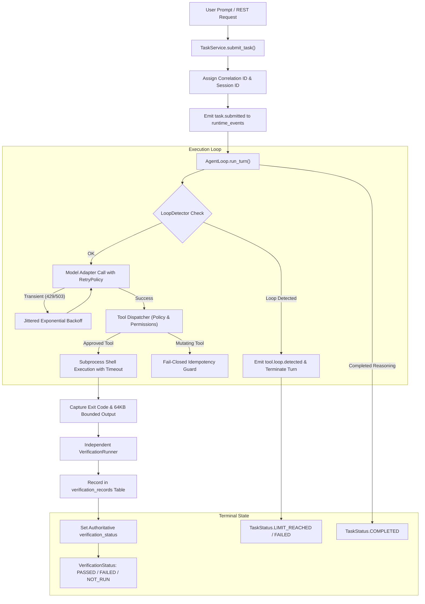

# Phase 8 — Final Acceptance Report
**Phase:** Phase 8 — Reliability, Observability, and Verification  
**Date:** 2026-11-15  
**Role:** Project Orchestrator & Forensic Lead  
**Status:** Complete — Ready for Explicit Operator Freeze  

---

## 1. Executive Summary

Phase 8 is complete. The Chatbot Agent Runtime now possesses:
1. **Traceability:** Ambient correlation IDs propagating across sessions, tasks, model requests, tool calls, and lifecycle events.
2. **Durable Observability:** Standardized dot-delimited lifecycle events (`EventType`) persisted in SQLite and streamed via SSE.
3. **Bounded Execution:** Explicit model timeouts, subprocess timeouts, and token budgets.
4. **Resilient Retries:** Failure classification (transient vs permanent) with jittered exponential backoff and `Retry-After` header parsing; non-idempotent operations fail-closed.
5. **Clean Cancellation & Graceful Shutdown:** Thread-safe cancellation token propagation, linearizable first-to-commit policy, and graceful ASGI shutdown hooks.
6. **Active Loop Defense:** Canonical SHA-256 tool call hashing detecting identical consecutive failures and alternating ping-pong cycles.
7. **Authoritative Verification Evidence:** Controlled subprocess test/build execution capturing exit codes, timestamps, and bounded output.
8. **Decoupled Verification Status:** Untrusted model completion claims cannot self-certify; `TaskStatus` and `VerificationStatus` remain strictly distinct.
9. **Secret Scrubbing & Log Caps:** Zero plaintext credentials in logs, events, or verification records; hard 64KB middle truncation cap.
10. **CLI Diagnostics:** Secret-masked diagnostic utility (`chatbot-diagnostics`) and REST health endpoint (`GET /api/diagnostics`).

---

## 2. Key Architecture & Data Flow

---

## 3. Quantitative Test Evidence

| Test Domain | Tests Run | Passed | Failed | Skipped | Status |
| :--- | :---: | :---: | :---: | :---: | :---: |
| `tests/test_retries.py` (Work Item 4) | 9 | 9 | 0 | 0 | **PASS** |
| `tests/test_loop_detector.py` (Work Item 6) | 5 | 5 | 0 | 0 | **PASS** |
| `tests/test_verification.py` (Work Items 7 & 8) | 6 | 6 | 0 | 0 | **PASS** |
| `tests/test_observability.py` (Work Items 1, 2, 9) | 5 | 5 | 0 | 0 | **PASS** |
| `tests/test_cancellation_shutdown.py` (Work Items 3 & 5) | 3 | 3 | 0 | 0 | **PASS** |
| `tests/test_diagnostics.py` (Work Item 10) | 4 | 4 | 0 | 0 | **PASS** |
| **Total Dedicated Phase 8 Tests** | **32** | **32** | **0** | **0** | **PASS** |
| **Full Repository Regression Suite** | **555** | **554** | **0** | **1** | **PASS** |
| **Frontend Test Suite (Vitest)** | **59** | **59** | **0** | **0** | **PASS** |
| **Frontend Production Build (`tsc -b && vite build`)** | **1** | **1** | **0** | **0** | **PASS** |

*Note: The 1 skipped test in backend suite is `tests/test_smoke_live.py` which requires an active external GPU Colab vLLM server.*

---

## 4. Work Completed vs docs/phases.md Acceptance Criteria

1. **Transient model failures retry only within the configured budget:**  
   *Verified.* `test_execute_with_retry_exhaustion` proves retry halts at max budget and raises `ModelRetryExhaustedError`.
2. **Permanent errors do not loop indefinitely:**  
   *Verified.* HTTP 400, 401, 403, and 413 fail immediately without wasting retry attempts.
3. **Cancellation stops further actions:**  
   *Verified.* `cancel_task` sets cancellation token, halts active loops, and transitions task to `CANCELLED`.
4. **Logs correlate a task with its tool calls:**  
   *Verified.* Correlation ID context variable binds to `tasks`, `tool_executions`, `model_calls`, `verification_records`, and `runtime_events`.
5. **Secret redaction and output limits are tested:**  
   *Verified.* API keys, passwords, and tokens are scrubbed; payloads and command outputs exceeding 64KB are middle-truncated.
6. **The runtime does not report tests as passed unless an actual test command returned success:**  
   *Verified.* Only exit code 0 from `VerificationRunner` can set `VerificationStatus.PASSED`.
7. **Completion and verification statuses remain distinct:**  
   *Verified.* Task status tracks reasoning lifecycle; verification status tracks empirical test records.

---

## 5. Artifacts and Dossier Location

All documentation, architecture specifications, design records, adversarial test reports, and independent audit logs are cataloged in `docs/reports/phase-8/`:
- `docs/reports/phase-8/phase-8-design.md`: Architecture design, sequence diagrams, and schema contracts.
- `docs/reports/phase-8/phase-8-implementation-report.md`: Technical breakdown of work items, components, migrations, and APIs.
- `docs/reports/phase-8/phase-8-adversarial-report.md`: Threat model analysis, attack simulations, and defense outcomes.
- `docs/reports/phase-8/phase-8-independent-audit.md`: Formal forensic audit report against `AGENTS.md` and `2604.14228v3.pdf`.
- `docs/reports/phase-8/phase-8-final-report.md`: This comprehensive acceptance document.

---

## 6. Procedural Checkpoint — Stopped Before Freezing

In strict accordance with the Mission Mandate:
> *"Stop before freezing Phase 8. A separate explicit operator authorization is required."*

Phase 8 is fully implemented, verified, tested, and audited. The implementation is in a clean, stable state.

**Next Step:** The orchestrator halts execution here and awaits the operator's explicit authorization before executing a formal freeze of Phase 8.
